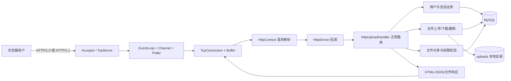
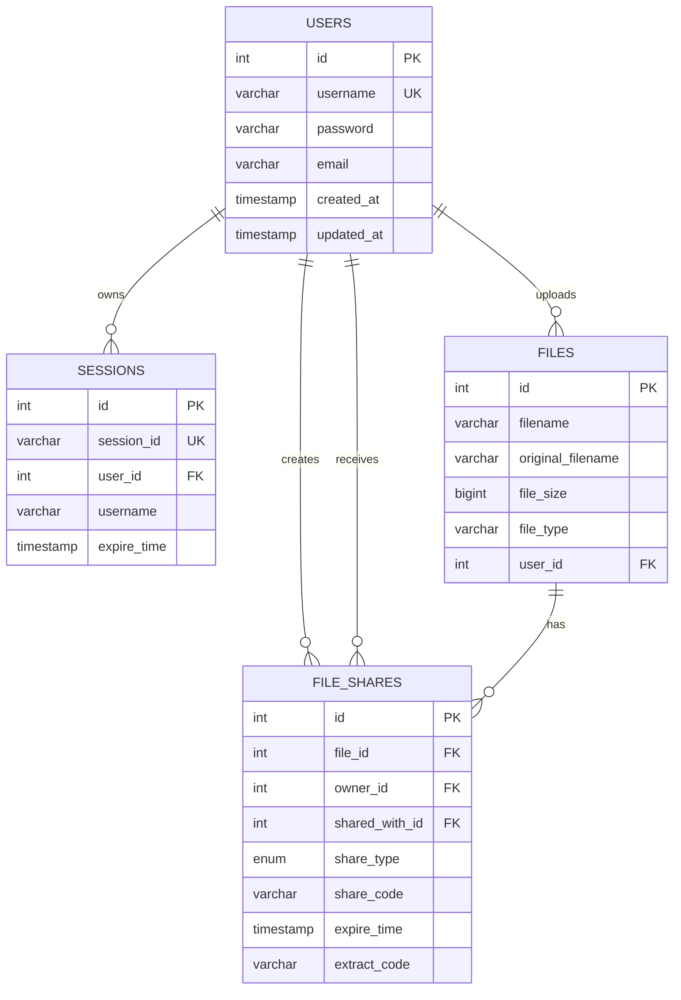

# Web 文件管理系统：项目介绍与技术架构

## 1. 项目概述

本项目是一个使用 C++17 编写的 Web 文件管理系统。项目没有依赖现成的 C++ Web 框架，而是在一个自研的、借鉴 Muduo 设计思想的事件驱动网络库之上，实现 HTTP 协议解析、路由分发、用户认证、文件上传下载和文件分享等功能。

系统由三部分组成：

- `base`：线程、同步、时间、日志和文件操作等通用基础设施。
- `net`：基于 Reactor 模式的非阻塞 TCP/HTTP 网络层。
- `application`：文件管理业务、MySQL 数据访问以及浏览器端页面。

服务启动后默认监听 `8000` 端口，浏览器访问 `http://localhost:8000` 即可进入系统。

## 2. 核心功能

- 用户注册、登录、退出及基于会话的身份验证。
- Multipart 文件上传，文件内容保存到本地 `uploads/` 目录。
- 查看自己的文件、分享给自己的文件以及公开文件。
- 文件下载、`HEAD` 请求和 HTTP Range 断点/分段请求。
- 删除文件及其关联的分享记录。
- 按用户名搜索可分享对象。
- 私有、公开、提取码和指定用户四种分享模式。
- 图片、视频等文件的浏览器端预览。
- 文件元数据、用户、会话和分享关系持久化到 MySQL。

## 3. 技术栈与运行环境

| 类别 | 技术/实现 |
| --- | --- |
| 开发语言 | C++17、HTML、CSS、JavaScript |
| 构建工具 | CMake 3.10+ |
| 网络模型 | Reactor、非阻塞 Socket、事件循环 |
| I/O 多路复用 | Linux `epoll`，可通过 `MYMUDUO_USE_POLL` 切换为 `poll` |
| HTTP | 项目内置 `HttpServer`、`HttpContext`、`HttpRequest`、`HttpResponse` |
| 数据库 | MySQL，C API（`mysqlclient`） |
| 数据格式 | JSON，使用 `nlohmann/json` |
| 文件系统 | `std::experimental::filesystem`、本地磁盘 |
| 并发基础设施 | pthread、EventLoopThreadPool、自研 ThreadPool |
| 日志 | 自研同步/异步日志组件 |

网络层使用了 Linux 的 `epoll`、`eventfd`、`timerfd` 及 `rt` 库，因此目标运行环境主要是 Linux。应用目标还显式链接 `stdc++fs`，更适合使用 GCC/libstdc++ 工具链构建。

## 4. 目录结构

```text
lesson29_file_manager/
├── CMakeLists.txt                 # 顶层构建配置
├── README.md                      # 原始使用说明
├── PROJECT_ARCHITECTURE.md        # 本文档
├── file_manager.sql               # 数据库初始化脚本
├── base/                          # 基础库 mymuduo_base
│   ├── Thread*                    # 线程、线程池
│   ├── Mutex.h / Condition.*      # 同步原语
│   ├── Timestamp.* / Timer...     # 时间相关工具
│   ├── Logging.* / LogFile.*      # 日志系统
│   └── FileUtil.*                 # 文件操作
├── net/                           # 网络库 mymuduo_net
│   ├── EventLoop.*                # 单线程事件循环
│   ├── Channel.*                  # fd 与事件回调的绑定
│   ├── Poller.* / poller/         # poll/epoll 封装
│   ├── Acceptor.* / Socket.*      # 监听与 Socket 封装
│   ├── TcpServer.*                # TCP 服务端与连接管理
│   ├── TcpConnection.*            # 连接状态、输入输出缓冲
│   ├── HttpServer.*               # HTTP 服务适配层
│   ├── HttpContext.*              # HTTP 请求增量解析状态机
│   ├── HttpRequest.h              # 请求模型、查询及路径参数
│   └── HttpResponse.h             # 响应模型与序列化
├── application/
│   ├── http_upload.cc             # 服务入口及全部文件管理业务
│   ├── index.html                 # 登录后文件管理主页面
│   ├── register.html              # 注册页面
│   ├── share.html                 # 分享访问页面
│   ├── player.js                  # 前端媒体分块加载辅助代码
│   └── route_test.cc              # 正则路由与 Trie 路由基准程序
├── docs/
│   └── cpp11_features.md          # C++ 特性说明
├── uploads/                       # 运行时生成，保存上传文件及映射 JSON
└── build/                         # CMake 构建产物（如已构建）
```

补充说明：`net/RouteTrie.*` 当前没有加入 `mymuduo_net` 的 CMake 源文件列表，正式业务路由仍使用 `http_upload.cc` 中的正则表达式顺序匹配；`route_test` 是独立的对比/实验程序。

## 5. 总体架构



### 5.1 分层职责

1. **基础设施层 `base`**
   提供网络层和业务层共用的线程、锁、条件变量、时间戳、文件及日志能力，最终编译为 `mymuduo_base` 静态/动态库目标。

2. **网络传输层 `net`**
   `EventLoop` 驱动 Poller 获取活跃事件；`Channel` 保存文件描述符关注的事件及回调；`Acceptor` 接受连接；`TcpConnection` 管理连接生命周期与读写缓冲。该层编译为 `mymuduo_net`。

3. **HTTP 协议层 `net`**
   `HttpContext` 以“请求行 → 请求头 → 请求体 → 完成”的状态机增量解析输入数据，`HttpServer` 将完整或可分段处理的请求交给上层回调，并把 `HttpResponse` 序列化到 TCP 连接。

4. **业务层 `application/http_upload.cc`**
   `HttpUploadHandler` 同时承担路由、认证、SQL 访问、文件 I/O 和响应组装。路由表按 HTTP 方法和正则表达式匹配，将路径参数写回 `HttpRequest` 后调用对应成员函数。

5. **表现层 `application/*.html`**
   页面使用原生 JavaScript 的 `fetch`/`XMLHttpRequest` 调用后端接口。登录后的 `sessionId` 和用户名保存在浏览器 `localStorage` 中，请求通常通过 `X-Session-ID` 头传递会话。

6. **持久化层**
   MySQL 保存结构化元数据，本地文件系统保存文件实体。`uploads/filename_mapping.json` 还保留服务端文件名到原始文件名的映射，但当前主要查询逻辑已使用数据库中的 `files.original_filename`。

## 6. 网络与并发模型

### 6.1 Reactor 调用链

```text
epoll/poll 就绪
  -> EventLoop 分发事件
  -> Channel 调用读回调
  -> TcpConnection 读取到 Buffer
  -> HttpServer::onMessage
  -> HttpContext::parseRequest
  -> HttpUploadHandler::onRequest
  -> 业务处理函数
  -> HttpResponse/TcpConnection 输出
```

`EventLoop` 使用 `eventfd` 实现跨线程唤醒，`TimerQueue` 使用 `timerfd` 管理定时任务。`TcpServer` 支持通过 `EventLoopThreadPool` 将连接轮询分配给多个 I/O Loop。

### 6.2 当前实际线程配置

- `main()` 调用 `server.setThreadNum(0)`，因此没有额外的 I/O 工作线程，连接和请求在主 EventLoop 中处理。
- `HttpUploadHandler(4)` 会启动一个包含 4 个线程的通用 `ThreadPool`，但当前代码没有向它提交业务任务。
- MySQL 使用一个共享的 `MYSQL*` 连接；在当前单 EventLoop 运行方式下业务访问基本串行，但若未来直接开启多 I/O 线程，需要改为连接池或线程独占连接，并审查所有共享状态。

因此，当前服务属于“具备多线程基础组件、实际以单 I/O 线程执行业务”的实现。大文件磁盘 I/O 和数据库查询可能阻塞事件循环。

## 7. 关键业务流程

### 7.1 注册、登录与会话

1. 注册接口接收 JSON，检查用户名是否存在后写入 `users`。
2. 登录接口校验用户名及密码摘要，生成 32 位随机会话 ID。
3. 会话写入 `sessions`，初始有效期为 30 分钟。
4. 每次 `validateSession` 成功后都会把有效期顺延 30 分钟。
5. 退出登录时删除对应会话记录。

### 7.2 文件上传

1. 客户端以 `multipart/form-data` 请求 `POST /upload`，并携带 `X-Session-ID`。
2. `HttpContext` 增量接收请求体；当上传体累计到一定大小时，`HttpServer` 可提前触发业务回调。
3. `FileUploadContext` 解析 multipart 边界和原始文件名，并把数据持续写入 `uploads/upload_<时间戳>_<随机数>`。
4. 上传完成后，系统识别文件类别，并向 `files` 表写入服务端文件名、原始文件名、大小、类型和所有者。
5. 返回文件 ID 和文件信息 JSON。

### 7.3 文件下载

1. 根据会话、文件所有者和可选的分享码/提取码进行权限检查。
2. `HEAD` 请求只返回文件大小及 `Accept-Ranges`。
3. `GET` 请求解析 `Range: bytes=start-end`，可返回 `206 Partial Content`。
4. `FileDownContext` 从指定位置开始读取，每次读取 1 MiB，并借助写完成回调继续发送下一块。

### 7.4 文件分享

分享关系保存在 `file_shares`：

- `private`：取消/不提供外部分享。
- `public`：持有链接即可访问。
- `protected`：访问时还需提供最多 6 位提取码字段。
- `user`：只允许指定的已登录用户访问。

分享可设置过期时间；查询语句在访问时判断 `expire_time` 是否为空或晚于当前时间。

## 8. HTTP 接口概览

| 方法 | 路径 | 会话要求 | 用途 |
| --- | --- | --- | --- |
| GET | `/`、`/index.html` | 否 | 返回主页面 |
| GET | `/register.html` | 否 | 返回注册页面 |
| GET | `/favicon.ico` | 否 | 返回站点图标 |
| POST | `/register` | 否 | 用户注册 |
| POST | `/login` | 否 | 用户登录并创建会话 |
| POST | `/logout` | 是 | 删除当前会话 |
| POST | `/upload` | 是 | 上传文件 |
| GET | `/files?type=my|shared|all` | 是 | 查询文件列表 |
| GET/HEAD | `/download/{filename}` | 是或有效分享参数 | 下载文件/查询文件信息 |
| DELETE | `/delete/{filename}` | 是，且必须为所有者 | 删除文件 |
| GET | `/users/search?keyword=...` | 是 | 搜索用户 |
| POST | `/share` | 是，且必须为所有者 | 创建、更新或取消分享 |
| GET | `/share/{code}` | 视分享类型而定 | 返回分享页或分享数据 |
| GET | `/share/info/{code}` | 视分享类型而定 | 查询分享文件信息 |
| GET | `/share/download/{filename}?code=...` | 视分享类型而定 | 下载分享文件 |

受保护接口主要使用请求头：

```http
X-Session-ID: <32 位会话 ID>
```

下载和媒体预览场景也支持通过 `sessionId` 查询参数传递会话。

## 9. 数据模型



外键均配置了级联删除：删除用户会删除其会话和文件；删除文件会删除关联的分享记录。

## 10. 构建与运行

### 10.1 依赖

建议在 Linux 环境安装以下依赖：

- GCC/G++（支持 C++17）
- CMake 3.10+
- pthread、rt
- Boost 开发包（顶层 CMake 会查找）
- MySQL Server 和 MySQL Client 开发包
- nlohmann/json 头文件

### 10.2 初始化数据库

先确认 `file_manager.sql` 的行为再执行。当前脚本第一条有效语句是 `DROP DATABASE file_manager;`，会删除同名数据库及其中已有数据。

```bash
mysql -u root -p < file_manager.sql
```

### 10.3 配置数据库连接

当前数据库参数是 `HttpUploadHandler` 构造函数的默认值：

```text
host: localhost
port: 3306
user: root
password: 123456
database: file_manager
```

它们尚未从配置文件或环境变量读取。如本机配置不同，需要修改代码或先完成配置化改造。

### 10.4 编译并启动

```bash
cmake -S . -B build
cmake --build build -j
./build/bin/http_upload
```

启动成功后访问：

```text
http://localhost:8000
```

运行目录下会自动创建 `uploads/`。页面文件路径通过编译时的 `__FILE__` 推导，因此移动源码目录或使用特殊的可复现构建路径时应额外验证静态页面加载。

## 11. 构建目标

| 目标 | 类型 | 说明 |
| --- | --- | --- |
| `mymuduo_base` | 库 | 基础设施组件 |
| `mymuduo_net` | 库 | TCP、Reactor 和 HTTP 组件，依赖 `mymuduo_base` |
| `http_upload` | 可执行文件 | 文件管理 Web 服务，依赖 `mymuduo_net`、`stdc++fs`、`mysqlclient` |
| `route_test` | 可执行文件 | 路由匹配性能实验 |

顶层 `BUILD_TESTS` 默认开启，但目前没有添加实际的 `tests` 子目录或 CTest 用例。

## 12. 当前实现的限制与风险

以下结论来自当前代码实现，适合作为继续开发时的优先检查清单：

1. **认证散列不适合生产环境**：名为 `sha256` 的函数实际使用 `std::hash<std::string>`，不是 SHA-256，也没有盐。应改用 Argon2、bcrypt 或 scrypt 等密码散列方案。
2. **敏感配置硬编码**：数据库账号和密码直接写在代码默认参数中，应迁移到受控配置或环境变量，并使用最小权限数据库账号。
3. **单线程阻塞风险**：数据库调用和文件读写发生在主 EventLoop 中，大文件或慢查询会影响所有连接；已创建的业务线程池目前未被使用。
4. **数据库连接扩展性**：当前只有一个 `MYSQL*`，若启用多 I/O 线程会有并发安全问题，应引入连接池和 RAII 封装。
5. **HTTP 能力不完整**：解析器识别 `Transfer-Encoding: chunked`，但请求体处理仍标记为 TODO；对畸形头部、超大头部和请求体大小也缺少系统性限制。
6. **下载 Range 边界需复核**：代码计算了请求的结束位置，但分块读取主要依据整个文件大小，可能发送超过所请求区间的数据。
7. **内存生命周期问题**：`handleShareInfo` 在 `mysql_free_result` 后仍引用 `MYSQL_ROW` 中的字段，存在释放后访问风险，应在释放结果集前复制所有数据。
8. **上传事务一致性**：磁盘文件写入与数据库记录写入没有事务/补偿机制，数据库失败时可能残留孤立文件。
9. **SQL 脚本具有破坏性**：初始化脚本会直接删除整个 `file_manager` 数据库，部署或升级时不能无审查复用。
10. **会话存储方式**：前端将会话 ID 放在 `localStorage`，部分下载请求还放入 URL；需考虑 XSS、访问日志和历史记录造成的泄露风险。
11. **CSRF、限流与审计不足**：当前没有看到 CSRF 防护、登录/上传限流、文件配额、病毒扫描或完整审计机制。
12. **测试覆盖不足**：项目有路由性能实验，但尚无覆盖 HTTP 解析、权限矩阵、上传边界、Range 下载和数据库异常的自动化测试。

## 13. 建议的演进方向

可按以下顺序逐步改造：

1. 修复结果集生命周期、Range 边界、错误回滚等正确性问题，并补充回归测试。
2. 将数据库密钥、监听地址、端口和上传目录外部配置化。
3. 使用成熟密码散列算法，改进会话传递方式并增加安全响应头、CSRF 与限流保护。
4. 把数据库与磁盘阻塞任务投递到业务线程池，响应结果再安全地切回所属 EventLoop。
5. 引入 MySQL 连接池、预处理语句和 RAII 资源管理，避免手工拼接 SQL 和资源泄漏。
6. 拆分当前较大的 `http_upload.cc`，形成 Router、AuthService、FileService、ShareService、Repository 等独立模块。
7. 完善 HTTP 协议边界、上传大小限制、文件类型/内容校验、磁盘配额和可观测性。
8. 增加单元测试、集成测试和端到端测试，并接入持续集成。

## 14. 一句话总结

这是一个适合学习 Reactor 网络编程和 Web 文件服务完整链路的 C++ 项目：底层网络库、HTTP 解析和文件业务均由项目自行实现；当前功能链路较完整，但在并发利用、模块拆分、安全性、协议健壮性和自动化测试方面仍有明显的工程化提升空间。
