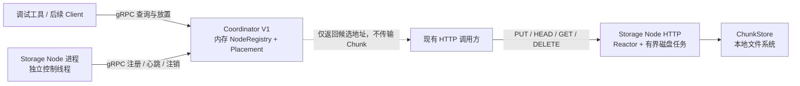
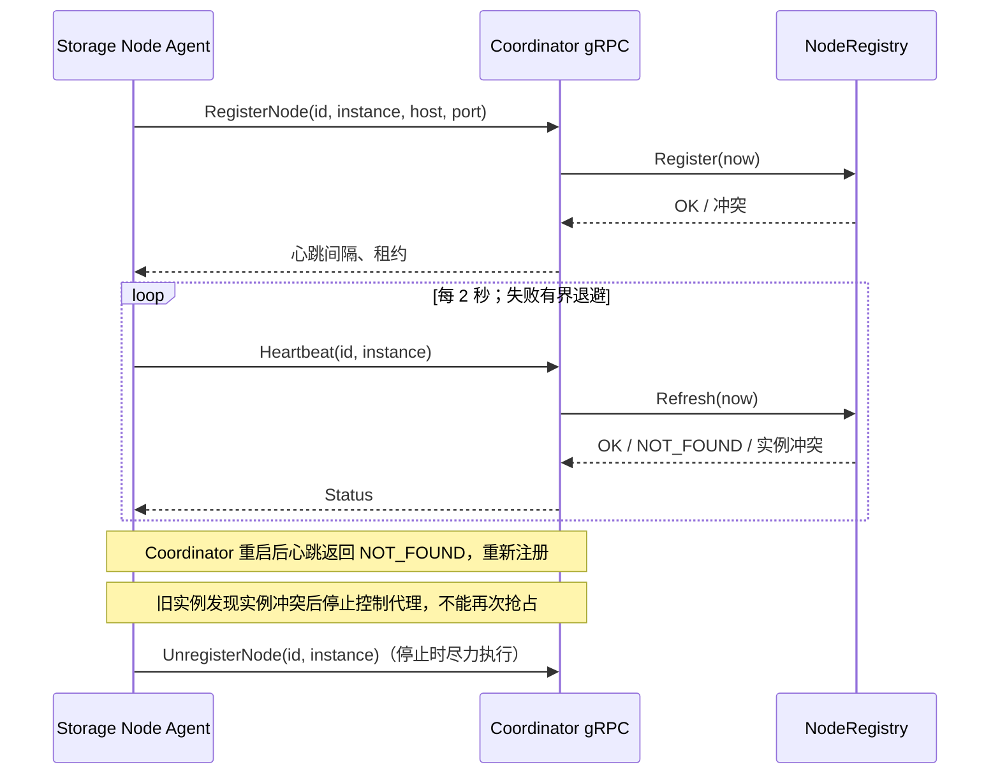

# Coordinator V1 技术设计与开发任务

> 状态：Coordinator V1 开发前的历史设计；其中“尚未实现”描述的是写作时点。节点注册、心跳和候选放置现已实现，实际行为以当前源码与测试为准。依据当时源码、[`README.md`](../README.md)、[Constitution](../.specify/memory/constitution.md)、[一期设计](01_object_storage_phase1_design.md)、[Storage Node HTTP 契约](03_storage_node_http.md)及 [V1 遗留问题](04_storage_node_v1_issues.md)。对象元数据、上传会话、复制与恢复仍属后续方向。

## 1. 当前架构与新增位置

已实现的 `storage/common/` 定义 Chunk ID、描述符、SHA-256 和错误类型；`storage/chunk_store/` 管本地持久化、提交和恢复；`storage/node/StorageNode.cc` 在一个 EventLoop 上处理 HTTP 连接，用有界磁盘线程池完成 Chunk I/O。进程入口 `apps/storage_node.cc` 负责参数、信号和退出。Node 目前没有注册、心跳或 Coordinator 依赖。参见 [`StorageNode.h`](../storage/node/StorageNode.h)、[`StorageNode.cc`](../storage/node/StorageNode.cc)、[`apps/storage_node.cc`](../apps/storage_node.cc)。



控制面采用 gRPC + Protobuf；数据面继续采用现有 HTTP 协议。Coordinator **不链接** `mymuduo::net`、`mymuduo::http`、`ChunkStore`，也不读取节点磁盘。Storage Node 的 gRPC 客户端放在进程入口附近的独立 `CoordinatorAgent`，无需改 `StorageNode` 的 HTTP 会话状态机、ChunkStore 接口或固定 64 KiB 数据窗口。客户端只报告“节点可被发现”，不能证明某个 Chunk 已写入或持久化。

## 2. V1 范围与明确排除

V1 必须支持：稳定 Node ID；启动注册和重复注册判断；周期心跳；超时离线和恢复上线；正常停止时尽力注销；按 ID/列表查询节点；按 Chunk ID 和期望副本数返回互不重复的在线节点；Coordinator 重启后节点自动重新注册；有界 RPC 超时、重试和有序退出。

V1 不实现对象/文件元数据、UploadSession、Chunk 库存、实际副本写入、复制、修复、重平衡、Raft、Coordinator 持久化或高可用、CRUSH、故障域和纠删码。期望副本数只是**候选节点数量**；即使返回三个节点，也不表示存在三个副本。没有租户认证和 TLS 的现有 HTTP 服务只适用于可信环境；gRPC V1 同样只在可信控制网络使用。

## 3. 数据模型与职责

| 组件（建议文件） | 职责与状态 | 依赖 |
| --- | --- | --- |
| `proto/coordinator_v1.proto` | 节点控制 RPC 与查询消息；生成代码位于构建目录 | Protobuf、gRPC |
| `coordinator/NodeRegistry.{h,cc}` | `unordered_map<NodeId, NodeRecord>`；校验、注册、心跳、注销、按 `steady_clock` 判断在线；注册时检查 endpoint 占用和按需清理离线记录；集中保护共享状态 | C++17、可复用 `storage/common/Types.h` 的 ID 校验，**不依赖 ChunkStore** |
| `coordinator/Placement.{h,cc}` | 输入在线节点快照、Chunk ID、数量；输出确定性的候选列表 | 通过 `object_store::common` 复用已有 SHA-256 能力 |
| `coordinator/CoordinatorService.{h,cc}` | 同步 gRPC Service 的薄适配：字段验证、调用 Registry/Placement、映射 `grpc::Status` | 生成的 proto、Registry/Placement |
| `apps/coordinator.cc` | 配置、监听、信号、`grpc::Server` 生命周期 | CoordinatorService |
| `storage/node/CoordinatorAgent.{h,cc}`（或同等局部文件） | 进程级 gRPC Client；独立线程完成注册、心跳、退避重试及注销 | 生成的 proto；不触碰 HTTP `Session`/`Buffer` |

这些组件承担不同的实际边界，不再增加 Repository 接口、工厂、事件总线或通用 RPC 封装。Coordinator 内存表只保存节点状态，没有 Chunk 所在位置。`NodeRecord` 最少含：规范化小写 UUID `node_id`、可供数据面访问的 `host`、`port`、进程启动时生成的 `instance_id`、是否已主动注销的标志、最近成功注册或心跳的 `steady_clock::time_point`、调试用最近接收时间 `Unix ms`。**Node ID 标识逻辑节点，instance ID 标识该节点的一次进程启动**：Node ID 由部署配置明确提供，重启沿用同一 ID；instance ID 每次进程启动新建随机 UUID。当前 `IsCanonicalId` 只检查 36 字符小写 UUID 形状，不检查 RFC UUID version/variant；V1 沿用该规范化规则即可。

`ONLINE/OFFLINE` 是查询时根据主动注销标志、最近成功注册/心跳与租约计算出的**派生状态**，不需要后台扫描线程。Registry 对每次注册、心跳、查询和放置都在锁内用当前 `steady_clock` 判断租约；因此没有查询流量时也不会把过期节点用于下一次放置。默认建议心跳间隔 2 秒、租约 10 秒、单次 RPC deadline 1 秒；作为配置校验 `lease > 3 × heartbeat_interval + rpc_deadline`。心跳/租约计时不使用会被校时影响的系统墙钟；墙钟字段只用于调试展示。

### 身份与地址规则

- 同一 `node_id + instance_id + endpoint` 的重复注册在 endpoint 没有被其他在线 Node ID 占用时幂等成功，并刷新租约。包括“Coordinator 已登记，但成功响应在网络中丢失”的重试；已过期或注销记录重新注册时仍须重新检查 endpoint。同一实例尝试更换 endpoint 返回 `FAILED_PRECONDITION`，原记录不变。主动注销后的同一实例若要重新上线，也必须显式注册。
- 同一 Node ID 有**在线的其他实例**时，新实例注册返回 `ALREADY_EXISTS`，旧实例仍为当前持有者。旧实例主动注销或租约过期后，新实例注册可接管，替换 instance ID 和 endpoint。接管成功后，旧实例的心跳/注销返回 `FAILED_PRECONDITION`，不得刷新租约或改变新记录；旧实例收到此明确冲突后将代理置为终止冲突状态，不再自动重注册。**租约已过期的同一实例不能仅靠心跳恢复**：心跳返回 `NOT_FOUND`，代理用原 Node ID/instance ID/endpoint 重新注册，使 endpoint 占用与 Node ID 接管检查再次执行。
- 心跳和注销必须带 Node ID 与 instance ID。未知 Node ID 返回 `NOT_FOUND`；实例不匹配先返回 `FAILED_PRECONDITION`；实例相同但记录已注销或租约已过期时，心跳返回 `NOT_FOUND`。注销把匹配记录标为非活跃；此后的心跳不能使其复活，已经注销的同一实例再注销可幂等成功。Coordinator 重启丢失表时，心跳也得到 `NOT_FOUND`，代理重新注册；但内存 Registry 丢失历史接管顺序，先到达的旧实例也可能注册成功，V1 **不提供跨 Coordinator 重启的持久化 fencing**。
- 不同 Node ID 不得同时声明同一个**有效** advertised endpoint。endpoint 以规范化后的 `(host, port)` 比较：IP 字面量按规范形式保存，DNS 名称按小写形式保存；注册时在同一把 Registry 锁下扫描在线记录（最多 1024 条），发现其他 Node ID 占用即返回 `ALREADY_EXISTS`，不得修改任一记录。已注销或租约过期的旧记录不阻止占用；原 Node ID 以新实例重注册时也要再次检查。DNS 别名或多个 IP 指向同一服务无法仅靠字符串比较识别，属于 V1 部署约束。
- V1 不做端点连通性探测。Node 必须在本地 ChunkStore 初始化和 HTTP 监听成功后才启动代理；注册成功仅说明控制 RPC 可达，不证明数据面可用。注册时校验端口 1–65535、非空且有长度上限的 advertised host；不把 `0.0.0.0`、`::` 或端口 0 作为返回给客户端的地址。测试中 HTTP 可绑定端口 0，再通过 `StorageNode::port()` 上报实际端口。

### 记录上限与按需清理

Registry 最多保留 **1024 条** Node ID 记录，包含在线和历史离线记录，不增加后台清理线程。注册已有 Node ID 不需要新槽位；仅在注册**新** Node ID 且表已满时，在同一把锁内按以下顺序腾出一个槽位：先删除已主动注销的记录，再删除租约过期的记录；每组按最近成功注册/心跳时间从旧到新选择，时间相同时按 Node ID 排序。仍无可清理记录才返回 `RESOURCE_EXHAUSTED`。无须为了腾位清理全部历史记录，查询可保留尚未被挤出的离线记录。被清理的 Node ID 的 `GetNode` 返回 `NOT_FOUND`，也不出现在 `ListNodes`；任何在线记录都不能被清理。一次注册中的清理、endpoint 冲突判断和插入须作为同一锁内操作；先完成字段及冲突检查，避免错误注册请求驱逐记录。失联的旧实例若在记录被清理后恢复，必须重新注册，其行为与 Coordinator 重启后首次注册相同，不能推断历史归属。

## 4. Protobuf / gRPC 接口草案

以下是任务实施时的起点。字段名和编号一经实现应保持兼容；V1 只用 unary RPC，不传文件字节。选 `proto3` 基本字段并显式校验默认零值，兼容当前环境检测到的 Protobuf 3.12.4；不依赖较新版本的 `optional` 字段存在性语法。

```proto
syntax = "proto3";
package object_storage.control.v1;

service Coordinator {
  rpc RegisterNode(RegisterNodeRequest) returns (RegisterNodeReply);
  rpc Heartbeat(HeartbeatRequest) returns (HeartbeatReply);
  rpc UnregisterNode(UnregisterNodeRequest) returns (UnregisterNodeReply);
  rpc GetNode(GetNodeRequest) returns (NodeInfo);
  rpc ListNodes(ListNodesRequest) returns (ListNodesReply);
  rpc GetPlacement(GetPlacementRequest) returns (GetPlacementReply);
}

message RegisterNodeRequest {
  string node_id = 1;
  string instance_id = 2;
  string host = 3;
  uint32 port = 4;
}
message RegisterNodeReply {
  uint32 heartbeat_interval_ms = 1;
  uint32 lease_timeout_ms = 2;
}
message HeartbeatRequest { string node_id = 1; string instance_id = 2; }
message HeartbeatReply {}
message UnregisterNodeRequest { string node_id = 1; string instance_id = 2; }
message UnregisterNodeReply {}
message GetNodeRequest { string node_id = 1; }
message ListNodesRequest {}
enum NodeState { NODE_STATE_UNSPECIFIED = 0; NODE_ONLINE = 1; NODE_OFFLINE = 2; }
message NodeInfo {
  string node_id = 1;
  string instance_id = 2;
  string host = 3;
  uint32 port = 4;
  NodeState state = 5;
  int64 last_seen_unix_ms = 6; // 仅供观测，不参与超时判断
}
message ListNodesReply { repeated NodeInfo nodes = 1; }
message GetPlacementRequest { string chunk_id = 1; uint32 replica_count = 2; }
message GetPlacementReply { repeated NodeInfo candidates = 1; }
```

接口错误表：格式非法、空 ID、非法 host/port、`replica_count == 0` 或超过配置上限（建议 16）→ `INVALID_ARGUMENT`；节点不存在或其历史记录已清理，以及匹配实例在注销/租约过期后继续心跳 → `NOT_FOUND`；在线 Node ID 被其他实例占用、有效 endpoint 被其他 Node ID 占用 → `ALREADY_EXISTS`；实例不符或同实例端点突变 → `FAILED_PRECONDITION`；可用节点不足 → `FAILED_PRECONDITION`，**不返回部分列表**；服务关停/暂时不可达 → `UNAVAILABLE`；客户端 deadline 到期 → `DEADLINE_EXCEEDED`。成功响应始终使用 gRPC OK。心跳和注册请求体只含小型标量；1024 条记录已满时先执行上述按需清理，仍无空位才以 `RESOURCE_EXHAUSTED` 拒绝新 Node ID；V1 不做分页，因此列表结果也受此上限约束。

## 5. 关键流程与放置算法



放置选 **Rendezvous Hashing**：从 Registry 取得同一时刻的在线节点快照；对每个节点计算 `SHA-256("coord-v1-placement" || 0x00 || canonical_chunk_id || 0x00 || node_id)`，按摘要字节序从大到小排序，平分时按 Node ID 字典序升序，取前 `replica_count` 个。分隔符是实际的单字节零值，构造输入时必须显式保留其长度。输入节点先按 Node ID 去重；同一成员集合、同一 Chunk ID 与数量得到相同顺序。摘要使用固定字节序和前缀，不能用 C++ `std::hash` 保证跨进程一致性。节点增加/失效会改变候选集；V1 **不记录历史放置、不迁移已有数据、不声称这些节点持有该 Chunk**。简单按 Node ID 排序会使所有 Chunk 总落在前几个节点；Rendezvous 算法稍多一次哈希和排序，但在最多 1024 个节点的 V1 范围内易测试且分布更合理。放置时先校验 Chunk ID 和请求数量；不足时直接报错，不降低副本数。

Registry 只在锁内生成在线快照，不持锁计算哈希或组装 protobuf。另需注意瞬时快照：返回后节点可能马上离线；调用方必须把放置结果当候选并处理实际 HTTP 失败。查询接口只给已知节点的在线/离线状态，不把 `GetNode` 当数据一致性证明。

## 6. 线程、同步、重试与生命周期

- **Coordinator Server**：使用 gRPC 同步 unary Service。gRPC 可并发调用处理函数；`NodeRegistry` 的 map 由一把 `std::mutex` 保护，注册、心跳、注销以及快照生成都在短临界区完成。`Placement` 对快照纯计算，不访问共享 map。锁内不做网络、磁盘或 SHA-256；目前只有一把业务锁，无锁顺序问题。同步 Service 是 V1 的直接方案，不自建 Reactor、CompletionQueue 或额外业务线程池。[gRPC C++ 入门](https://grpc.io/docs/languages/cpp/basics/)明确提醒同步 Service 处理函数要线程安全。
- **Storage Node Agent**：`apps/storage_node.cc` 在 `node.Start()` 成功后启动一条专用线程；该线程独占 gRPC stub、注册状态、心跳和退避计时，不访问 EventLoop 的连接、`Buffer`、`Session` 或 `ChunkStore`。同步 RPC 只在此线程调用，避免阻塞现有唯一数据面 I/O Loop 或占用有界磁盘任务队列。线程之间仅用互斥量/条件变量传递停止标志；等待可被停止唤醒。
- **失败处理**：每次 RPC 设置明确 deadline（建议 1 秒；租约配置相应留余量）。`UNAVAILABLE`/`DEADLINE_EXCEEDED`/`RESOURCE_EXHAUSTED` 使用带抖动的有界指数退避，例如 0.5 秒至 5 秒；`NOT_FOUND` 心跳转注册。注册成功响应丢失时，重发**完全相同**的 Node ID、instance ID 和 endpoint，依靠幂等注册收敛。心跳收到实例不符的 `FAILED_PRECONDITION`，或注册因同实例 endpoint 变化得到该错误时，立即进入**终止冲突状态**：停止心跳和自动注册，报告明确错误，待部署方处理。注册返回 `ALREADY_EXISTS` 时，可能是合法新实例等待旧租约到期，也可能是重复 Node ID/endpoint 配置错误；只在从首次冲突起的**可配置最大冲突等待窗口**内按慢间隔重试，仍冲突则进入终止冲突状态，不无限争抢。默认窗口建议 15 秒，覆盖默认 10 秒租约；自定义租约时应相应配置窗口，因为首次注册冲突时代理尚未收到服务端租约。终止冲突状态只在进程重启或显式配置修正后解除。代理收到 `NOT_FOUND` 时无法区分 Coordinator 重启与历史记录被清理；重新注册仍受当前 Node ID/endpoint 冲突检查约束。gRPC 默认不为调用设置 deadline，因此必须显式设置。[gRPC deadline 指南](https://grpc.io/docs/guides/deadlines/)
- **正常关闭**：沿用现有 `sigwait → loop.quit() → loop.loop()` 返回的路径；返回后唤醒代理线程、停止新心跳、尝试一次有 deadline 的 `UnregisterNode` 并 join，随后才析构 `StorageNode`。代理不持有 Node/Loop 指针。EventLoop 退出到注销完成之间，Coordinator 可能短暂显示在线；注销失败则等租约超时。每个阻塞 RPC 有 deadline，join 时延有界。Coordinator 收信号后对 gRPC Server 有界 `Shutdown` 再 `Wait`，所有 Service/Registry 对象应活到 Wait 返回。[gRPC 关闭指南](https://grpc.io/docs/guides/server-graceful-stop/)
- **Coordinator 重启**：内存表丢失是预期行为。仍正常运行的节点代理在下一次心跳获 `NOT_FOUND` 后重新注册；重建期间放置可能返回节点不足。若**尚未获知接管的旧实例**与新实例都能联系到重启后的 Coordinator，先注册者可能取得该 Node ID；已进入终止冲突状态的代理不会自动重新注册。内存 Registry 无法证明谁在重启前已接管，V1 不提供持久化 fencing，也不保证 Coordinator 宕机期间的控制面可用或凭注册恢复 Chunk 库存。部署方须避免同一 Node ID 的旧进程与新进程同时运行。

## 7. 构建集成与配置

根 [`CMakeLists.txt`](../CMakeLists.txt) 目前固定 C++17、Linux、CMake 3.16+，用 `add_subdirectory(storage)`、`apps`、`tests` 组织目标；尚无 gRPC/Protobuf 目标。建议新增 `MYMUDUO_BUILD_COORDINATOR`（默认 `OFF`），开启时才检测依赖并构建 `proto/`、`coordinator/`、`coordinator` 可执行文件及启用控制代理的 `storage_node`。根 CMake 在 HTTP 或 Coordinator 任一开启时加入 `apps/`，其中 `storage_node` 目标仅在 HTTP 开启时定义，`coordinator` 目标仅在 Coordinator 开启时定义；因此 Coordinator 可在 HTTP 关闭时独立构建。关闭 Coordinator 时，原有 HTTP/ChunkStore 与 `MYMUDUO_BUILD_HTTP=OFF` 核心构建保持可用。V1 的 Coordinator 可执行目标不链接 `mymuduo::net/http`；仅启用控制代理的 Storage Node 进程额外链接生成的 gRPC client。

当前工作环境可检测到 `protoc`、`grpc_cpp_plugin`、`grpc++` 1.30.2、Protobuf 3.12.4；已安装 gRPC++ 的 pkg-config 文件，未在常用库路径找到 gRPC CMake config。因此本仓库 V1 推荐 `find_package(Protobuf REQUIRED)`、`find_package(PkgConfig REQUIRED)`、`pkg_check_modules(GRPCPP REQUIRED IMPORTED_TARGET grpc++)`、`find_program(GRPC_CPP_PLUGIN_EXECUTABLE grpc_cpp_plugin)` 并在找不到插件时显式 `message(FATAL_ERROR ...)`，兼容现有 CMake 3.16 下限。由 CMake `add_custom_command` 生成 `.pb.cc/.h` 与 `.grpc.pb.cc/.h` 到构建目录；把生成目录只加入相关 target 的 include path。Protobuf 运行库与编译器版本必须匹配；配置阶段检查缺失依赖并给出明确错误，不下载或 vendoring 大型依赖。官方 [gRPC C++ CMake 示例](https://github.com/grpc/grpc/blob/master/examples/cpp/helloworld/CMakeLists.txt)展示了 `protoc` 加插件生成代码的方式；若未来统一升级依赖，可改用其官方 CMake package，但不必在 V1 同时维护两套构建路径。

可执行参数建议保留既有 `storage_node ROOT PORT` 的本地运行模式；启用控制面时明确提供 Coordinator 地址、稳定 Node ID 和 advertised host，监听实际端口从 `node.port()` 取得。`coordinator` 接收监听地址与租约配置，节点表硬上限为 1024；启动时验证参数。不要依赖机器 hostname 自动推断外部可达地址。文档与命令行帮助应说明单实例、内存状态和可信网络前提。

## 8. 分阶段开发任务与验收

| 阶段 | 具体任务 | 验收标准与关键测试 |
| --- | --- | --- |
| **A. 构建与协议** | 新增开关、proto、生成规则、Coordinator/Agent 目标；校验包与生成工具版本；定义 RPC 字段、错误契约和配置默认值。 | 开关 OFF 时现有构建与测试不受影响；ON 时 clean build 生成 protobuf/gRPC 文件且 Coordinator 不链接 Reactor；错误包配置有清晰诊断。字段内容校验留到 C 阶段 Service 实现。 |
| **B. Registry 与放置纯逻辑** | 实现稳定 ID、实例冲突、租约、重注册/注销、在线快照、有效 endpoint 唯一性和容量满时按需清理；实现固定摘要的 Rendezvous 排序。 | 单元测试覆盖同实例重复注册（含成功响应丢失后用相同参数重试）、不同实例冲突、旧实例失联后超时接管、旧实例恢复时心跳/注销被拒、同一/不同 Node ID 的 endpoint 占用、过期/注销记录释放 endpoint、1024 条满时按优先级清理、全在线时拒绝且不驱逐、超时边界、零/超额副本数、节点不足、无重复节点、节点增减后的确定性；可传入 `steady_clock::time_point` 测试超时，无需睡眠或时钟接口。 |
| **C. gRPC Server 与查询** | 实现同步 Service、**Protobuf 字段校验**、状态映射、`coordinator` 入口与有界关停。 | 真 gRPC client 测试注册/心跳/注销、GetNode/ListNodes/GetPlacement，空 ID/零端口/非法 host/副本数等字段及各错误码；验证重复 endpoint 的 RPC 错误和清理后 `GetNode` 的 `NOT_FOUND`；并发注册/心跳/查询/放置无数据竞争，TSan 可用时运行或以多线程重复测试验证；`SIGTERM` 后在设定时限内退出。 |
| **D. Storage Node 接入** | 添加进程级 Agent 和启动参数，Start 成功后注册，专用线程心跳/重试；处理有限冲突重试与终止冲突状态；退出时停止并尽力注销。 | 现有 HTTP 集成测试继续通过；模拟注册成功但响应丢失，验证相同参数重试收敛；旧实例获实例冲突后停止自动重试；Coordinator 暂停或重启时 HTTP PUT/GET 仍可进展，不被 gRPC 阻塞；重启后自动重新注册，节点关闭后立刻或租约到期离线；代理与 Node 析构无悬空回调。 |
| **E. 多进程验收** | 用临时 root 启动一个 Coordinator 和至少三个 Storage Node；启动/停止/杀死/重启进程，查询节点与放置结果。 | 三节点时请求两个候选得到两个不同且在线的 ID，重复查询在成员不变时顺序相同；杀死旧实例后新实例须等租约过期接管，恢复的旧实例不能重获租约或无限重试；故障节点不再被选择；节点不足返回完整错误而非部分结果；不同 Node ID 的重复 endpoint 被拒，旧记录过期或注销后可被复用；Coordinator 重启后运行中的节点重新注册，并记录旧/新实例同时存在时无法恢复历史接管顺序的限制；三节点各自 HTTP 数据接口仍可用。 |

每阶段结束只记录**实际运行**的命令和结果；运行受环境限制时如实写明。建议回归命令为 `cmake --build build -j4`、`ctest --test-dir build --output-on-failure`，再单独构建启用 Coordinator 的配置并运行新增测试；ASan/UBSan 沿用现有 `build-sanitize` 配置检查相关路径。多进程测试必须设置超时、清理子进程与临时目录，避免失败后残留服务。

## 9. 现阶段风险和后续边界

内存 Registry 意味着 Coordinator 重启后状态短时为空，且没有对象/Chunk 库存或历史实例接管顺序；本次进程内的 instance ID 检查不能充当跨重启的持久化 fencing。容量满时清理的离线记录也会丢失历史身份信息，旧实例再次出现将被视作新注册请求。endpoint 唯一性仅针对规范化后相等的地址文本，不能识别 DNS 别名和实际网络转发关系。心跳只是“控制线程还活着”，不等于磁盘健康或 HTTP 可达。放置结果不是副本记录，不能作为读取、删除或修复的权威依据。以后增加真实副本写入时，需引入持久化元数据、提交确认与对账，而不是在当前节点表上追加一个 `has_chunk` 布尔值。

[Storage Node V1 遗留问题](04_storage_node_v1_issues.md)中的删除后同步失败、分片祖先目录同步失败、trash 回收、请求头/超时等问题未因接入 Coordinator 而消失。V1 可先完成节点控制面的独立开发；在宣称可靠副本放置、删除后恢复或严格 `201/204` 崩溃持久化保证前，须按该清单补齐修复与故障测试。控制面当前无认证/TLS，部署边界只能是可信网络；引入不可信客户端访问时需先设计身份、授权与网络隔离。
