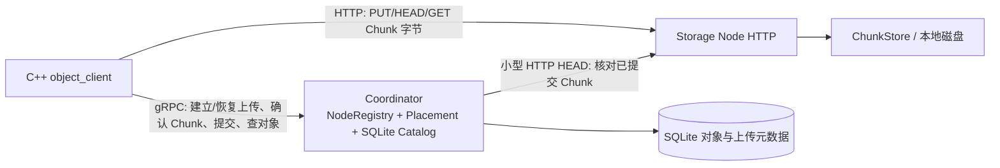
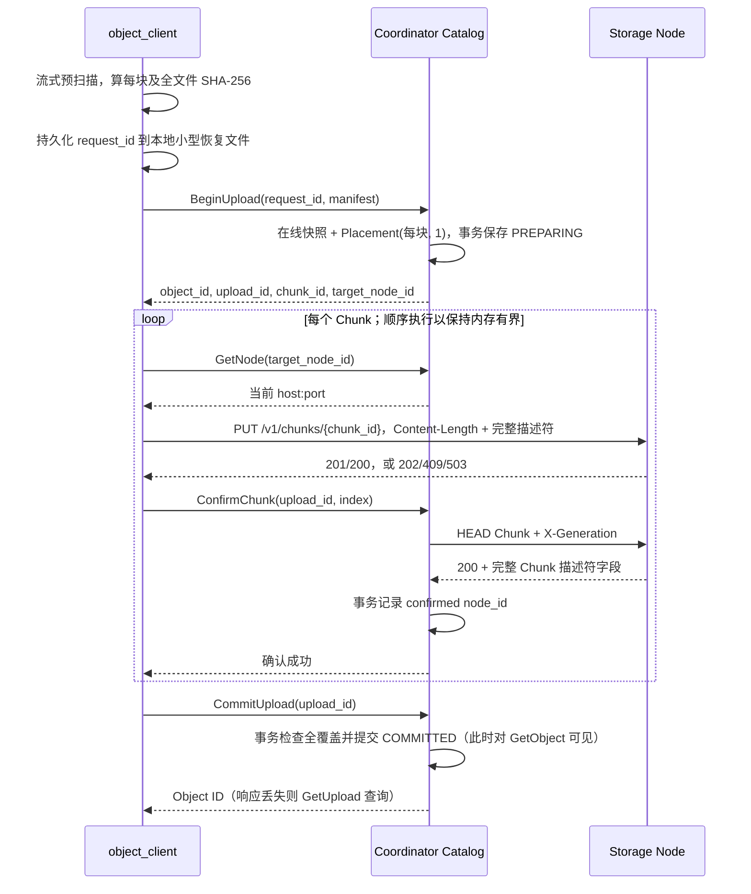
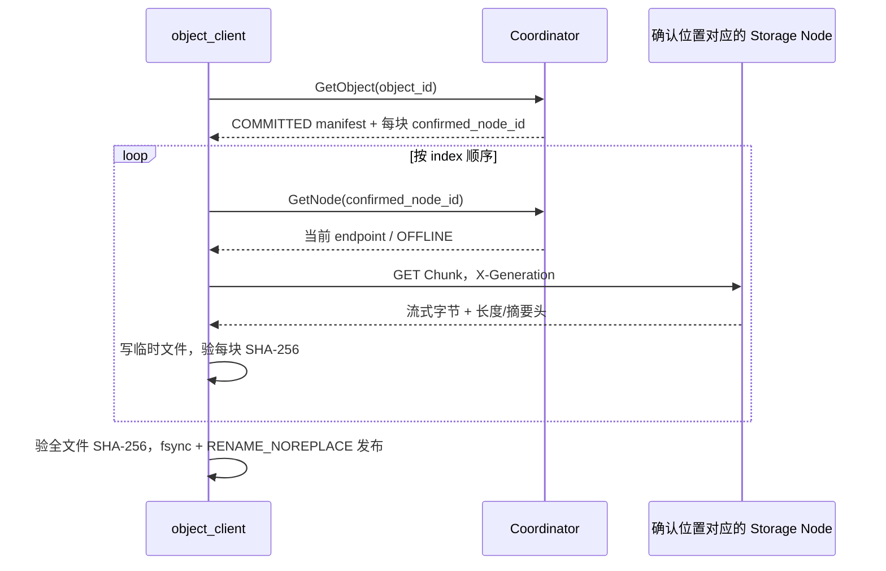

# 单副本对象上传与下载：设计及开发任务

> 状态：下一阶段设计，本文的对象目录、上传会话和 C++ Client **尚未实现**。依据当前 `proto/coordinator_v1.proto`、`coordinator/NodeRegistry.*` / `Placement.*` / `CoordinatorService.*`、`storage/node/StorageNode.*`、`storage/chunk_store/*`、现有测试、README、Constitution 和本目录历史设计。本文只规划单 Coordinator、单副本完整对象链路，不把 V1 的候选节点误写成已持有 Chunk 的节点。

## 1. 目标、边界与现有能力



目前 `GetPlacement(chunk_id, 1)` 只从在线 `NodeRegistry` 返回候选节点，不写入记录；Coordinator 重启会丢失节点表。Storage Node 已有 `PUT /v1/chunks/{id}`、`HEAD` 查询、`GET` 和单段 Range；`ChunkStore` 的描述符已含 `chunkId`、`objectId`、`objectVersion`、`index`、`logicalOffset`、`size`、SHA-256 与 `generation`。但当前 [`DescriptorHeaders()`](../storage/node/StorageNodeHttp.cc) 只返回 Generation、大小、SHA-256，HEAD 尚不足以让 Coordinator 核对完整上传计划；本阶段需在**现有 HEAD** 响应中补齐字段。完整 Chunk 的 PUT 返回 `201`，描述符一致的重复 PUT 返回 `200`；未完成片段可返回 `202`，HEAD 可返回可续传的 `308`。Node 单次 PUT 内部按 64 KiB 窗口写入与 Checkpoint，最大 Chunk 默认 256 MiB。参见 [`StorageNode.cc`](../storage/node/StorageNode.cc)、[`ChunkStore.h`](../storage/chunk_store/ChunkStore.h) 和 [现有 HTTP 契约](03_storage_node_http.md)。

本阶段使 `object_client upload FILE` 得到 Object ID，使 `object_client download OBJECT_ID OUTPUT` 根据**已确认位置**重建文件。只支持新建不可变对象，`version=1`、`generation=1`、每 Chunk 一个目标节点和一个确认位置；不提供覆盖、删除、用户 key、去重、多副本、自动迁移、修复或 Coordinator HA。文件字节不经过 Coordinator。操作假设可信网络和稳定的 Node ID ↔ 存储 root 绑定；现有节点注册并未验证磁盘身份。

## 2. 必须新增的组件与可复用部分

| 组件 | 必要职责 | 直接复用 / 不做的事 |
| --- | --- | --- |
| `coordinator/ObjectCatalog.{h,cc}` | 持有一个 SQLite 连接和互斥量；保存上传计划、Chunk 确认及对象提交，使用事务控制可见性 | 不复制 ChunkStore 的文件格式；不引入 Repository 接口或 ORM |
| 现有 `CoordinatorService` 与 `proto/coordinator_v1.proto` 的增量 RPC | 建立/查询上传、确认 Chunk、提交、查已提交对象；继续使用现有同步 gRPC Server | 保留 NodeRegistry、Placement 和现有节点 RPC；不新增一套 gRPC 服务框架 |
| `coordinator/ChunkProbe.{h,cc}` 中的小型函数 | 对计划目标发 HTTP HEAD，核对状态 `200` 和完整 Chunk 描述符 | 不下载内容、不做全量校验；用 libcurl，不依赖 Reactor |
| `client/ObjectClient.{h,cc}` 与 `apps/object_client.cc` | 流式算摘要、gRPC 控制调用、libcurl 流式 PUT/HEAD/GET、断点续传与文件落盘 | 复用现有 HTTP 协议和生成的 gRPC stub；不把大文件放入 `std::string` |

直接复用 `coordinator::GetPlacement(chunkId, 1, onlineSnapshot)` 为每个 Chunk 选**初始目标**；同一上传固定此目标，不因后续成员变动改写。读路径使用 Catalog 保存的确认 Node ID，再通过已有 `GetNode` 查当前 endpoint，**绝不重新跑 Placement 找“可能持有者”**。Client 的 HTTP 可以用 libcurl 回调做固定长度流式传输：这样无需把 Coordinator 绑到 `mymuduo::net`，也无需为命令行程序自造非阻塞 HTTP 框架。[libcurl 文件上传示例](https://curl.se/libcurl/c/fileupload.html)展示了固定长度上传方式。

## 3. 数据模型与 SQLite 边界

本阶段 Chunk 大小**固定为 64 MiB**，不由 Client 配置，`BeginUpload` 也不接收 `chunk_size`。非最后一块必须恰好 64 MiB；最后一块大小为 `1..64 MiB`，恰好整除时最后一块也是 64 MiB，不额外创建零字节 Chunk；空对象必须是零 Chunk、总大小 0、空字节 SHA-256，仍需显式提交对象。单对象最多 **1024 块**，最大总大小为 `1024 × 64 MiB = 64 GiB`，低于当前 ChunkStore 默认的单 Chunk 256 MiB 上限。服务端按 `ceil(total_size / 64 MiB)`（空对象为 0）校验清单块数，逐块校验 `index=0..n-1`、`offset=index × 64 MiB`、块大小与全文件大小完全一致；自定义大小、零长度非空 Chunk、缺块、重叠、额外块及越界均为 `INVALID_ARGUMENT`。请求及响应序列化后须低于当前 Coordinator Server 的 1 MiB gRPC 消息限制（[`apps/coordinator.cc`](../apps/coordinator.cc)）；超限返回 `RESOURCE_EXHAUSTED`。Client 先用 64 KiB 左右的读缓冲扫描文件一遍，算每块和全文件 SHA-256，再提交清单；第二遍按块上传。多一次顺序读换来上传前不可变的校验描述符与简单重试。`file_size`、offset 和 SQLite `INTEGER` 均检查在有符号 64 位范围内。

建议只用三张表（名称可在实施时按现有风格调整）：

```text
objects(
  object_id TEXT PRIMARY KEY, request_id TEXT UNIQUE NOT NULL,
  upload_id TEXT UNIQUE NOT NULL, version INTEGER NOT NULL, state TEXT NOT NULL,
  total_size INTEGER NOT NULL,
  file_sha256 TEXT NOT NULL, created_ms INTEGER NOT NULL, committed_ms INTEGER)
  state = PREPARING | COMMITTED | ABORTED

chunks(
  chunk_id TEXT PRIMARY KEY, object_id TEXT NOT NULL REFERENCES objects,
  chunk_index INTEGER NOT NULL, logical_offset INTEGER NOT NULL,
  size INTEGER NOT NULL, sha256 TEXT NOT NULL, generation INTEGER NOT NULL,
  target_node_id TEXT NOT NULL,
  UNIQUE(object_id, chunk_index))

chunk_locations(
  chunk_id TEXT PRIMARY KEY REFERENCES chunks, node_id TEXT NOT NULL,
  confirmed_ms INTEGER NOT NULL)
```

`target_node_id` 是上传计划；`chunk_locations.node_id` 才是 Coordinator 用 HEAD 核对后记录的**实际位置**。V1 用 `chunk_id` 唯一键强制最多一条确认位置；以后支持多副本时迁移此小表为复合主键，而不改变 Chunk 顺序表。数据库不存 endpoint，因为节点可能换地址；查询时用当前 Registry 解析 Node ID。`request_id` 是 Client 在首次 RPC 前生成并保留的小写 UUID，作为 `BeginUpload` 的幂等键；同键同清单返回原计划，同键不同清单返回 `ALREADY_EXISTS`。`object_id`、`upload_id` 与 `chunk_id` 由 Coordinator 生成并在事务中保存，不能在重试时重新生成。`version=1`、`generation=1` 的约束直接写入 V1 校验。

Catalog 在本地文件系统上使用 SQLite，建议 `journal_mode=WAL`、`synchronous=FULL`、每连接 `foreign_keys=ON`，设置有限 `busy_timeout`；启动时检查 schema version，未知版本拒绝服务。`BeginUpload` 用一个事务插入对象和全部 Chunk 计划；`ConfirmChunk` 在 HEAD 成功后用事务插入确认位置；`CommitUpload` 用 `BEGIN IMMEDIATE` 检查完整性并更新 `state=COMMITTED`。**整个 Object 的可见时点是该 SQLite 事务成功提交**，与 Commit RPC 响应是否送达客户端无关。成功提交后 `GetObject` 可见；RPC 超时或响应丢失时，Client 通过 `GetUpload` 查 `COMMITTED/PREPARING` 再决定后续动作，不把超时当作未提交。SQLite 事务承担**元数据内部**的原子发布，不承担与各 Storage Node 的跨机器原子事务。[SQLite 事务](https://www.sqlite.org/lang_transaction.html)、[WAL 与同步语义](https://www.sqlite.org/pragma.html)、[外键设置](https://www.sqlite.org/foreignkeys.html)是此选择的依据。

沿用单 Coordinator 约束：进程启动前对 `<db-path>.lock` 取得并持有排他 `flock`，防止两个 Coordinator 用同一 DB 却拥有各自内存 NodeRegistry。SQLite 连接由 Catalog 拥有，gRPC 同步调用可并发进入，但用一把 Catalog 互斥锁串行短事务和查询；**绝不持 Catalog 锁或 SQLite 写事务做 HTTP HEAD、gRPC、文件哈希或长时间等待**。NodeRegistry 自有锁；先取在线快照再访问 Catalog，不嵌套两把锁。服务停接收 RPC、等待 gRPC Server `Wait()` 返回后再关闭 Catalog。SQLite/磁盘错误必须返回明确失败，不能把未确认事务当作对象已提交。

> 工具链检查：当前环境有 SQLite/libcurl 运行库，但未找到对应开发头文件或 pkg-config 描述；实现阶段需补齐开发包后才能让新增 target 构建。本轮不安装依赖。CMake 将新依赖限定在 Coordinator 对象目录/探测和 Client 目标，不影响原有 `MYMUDUO_BUILD_COORDINATOR=OFF` 构建。

## 4. 控制 RPC 初稿

在现有 `Coordinator` service 中增加下列 unary RPC，不传文件字节；复用现有 UUID 规范和 gRPC deadline。精确字段编号在修改 `.proto` 时一次固定，避免这里给出与现有文件可能冲突的编号。

**现有 HEAD 的最小扩展**：`StorageNode::StartLookup()` 已通过 `ChunkStore::Stat()` 取得完整 `ChunkDescriptor`，无需新探测接口。在 `StorageNodeHttp.cc` 的 `DescriptorHeaders()` 补 `X-Chunk-Id`、`X-Object-Id`、`X-Object-Version`、`X-Chunk-Index`、`X-Logical-Offset`；保留已有的 `X-Chunk-Size`、`X-Checksum-Sha256`、`X-Generation`。该公共 helper 也用于 GET 和可续传的 `308`，新增字段不会改变其状态语义。`ConfirmChunk` 对现有路径发 `HEAD /v1/chunks/{chunk_id}` 并携带 `X-Generation`，只接受 **200 已提交**，严格解析并逐项比较响应的这八个字段与 SQLite 计划（同时核对 URL 中的 Chunk ID）；字段缺失、格式错误或任一不匹配均不得确认。`308` 仅供续传，不能证明 Chunk 已提交；HEAD 不重新扫描文件内容，内容损坏仍靠下载时校验发现。

| RPC | 输入 | 成功返回与语义 |
| --- | --- | --- |
| `BeginUpload` | `request_id`、`total_size`、`file_sha256`、有序 `{index, offset, size, sha256}` 清单；**无 Chunk 大小参数** | 按固定 64 MiB 规则验证清单，持久化 `PREPARING` 计划后返回 `object_id`、`upload_id`、`version` 和逐块 `{chunk_id, generation, target_node_id}`；同键同清单幂等。无在线目标则整体失败，不留下部分计划；空对象无需目标节点。 |
| `GetUpload` | `request_id` | 返回 `PREPARING/COMMITTED/ABORTED`、原始计划、逐块是否已确认；用于 Begin/Commit 响应丢失和进程重启后的恢复。不是公开可下载对象查询。 |
| `ConfirmChunk` | `upload_id`、`chunk_index` | Coordinator 从持久化计划取 target Node ID，经当前 Registry 查 endpoint，**在数据库锁外**发已有 HEAD；仅 `200` 且 Chunk ID、Object ID、版本、序号、逻辑偏移、大小、SHA-256、Generation **全部匹配**才以事务记录该 Node ID。重复确认同位置幂等；`308`、`404`、`409`、HEAD 超时均不能确认。 |
| `CommitUpload` | `upload_id` | 单事务要求所有 Chunk 已确认、顺序和总大小仍有效，再将对象设为 `COMMITTED`；重复提交返回同一 Object ID。零 Chunk 对象也可提交。响应丢失由 `GetUpload` 查询，不生成第二个对象。 |
| `AbortUpload`（后续补充） | `upload_id` | 只把未提交对象标记为 `ABORTED`，不发送 Storage Node DELETE；重复 Abort 幂等，已提交不可 Abort。清单和已上传 Chunk 暂留供后续 GC，V1 明确不承诺回收。**不阻塞首次小文件端到端验收**。 |
| `GetObject` | `object_id` | 只返回 `COMMITTED` 对象的版本、总大小、全文件摘要及按 index 排序的 `{chunk_id, offset, size, sha256, generation, confirmed_node_id}`；不存在或未提交返回 `NOT_FOUND`。Client 用已有 `GetNode` 解析当前地址。 |

`BeginUpload` 先查同 `request_id` 的持久化记录并比较清单；新请求对一次在线节点快照逐块调用已有 Placement，然后在事务中插入所有行。并发同键请求由 `UNIQUE(request_id)` 收敛到同一行；冲突事务重新读取并比较，不能返回另一套 ID。`ConfirmChunk` 的网络探测先执行，事务内再检查对象仍为 `PREPARING`、目标未改变、确认位置未冲突；因此 Abort/Commit 与在途 HEAD 交错不会发布未经确认的记录。`CommitUpload` 只使用数据库里的确认状态，不信任客户端的 `201` 声明，也不在事务里逐块重做 HEAD。它**不保证**确认到提交之间节点不会掉线；单副本版本在节点失效时会暂时或永久不可读。

错误语义：非法 ID、超过 64 GiB/1024 块限制、不符合固定 64 MiB 分块规则、非连续 offset 或不合法摘要 → `INVALID_ARGUMENT`；无在线候选/目标未注册或离线/HTTP 探测不可达 → `UNAVAILABLE` 或 `FAILED_PRECONDITION`（区分临时不可达与计划不足）；同 request ID 不同清单、同 Chunk 不同确认目标 → `ALREADY_EXISTS`；HEAD 描述符缺失或不匹配、未确认全部 Chunk、已 Abort、状态不匹配 → `FAILED_PRECONDITION`；SQLite `BUSY`/I/O/磁盘满 → `UNAVAILABLE` 或 `INTERNAL`，日志保留底层码。不能从 RPC 超时推断事务没提交；客户端必须查 `GetUpload`。`GetObject` 返回成功只说明元数据已发布，下载仍须验证实际节点与数据。

## 5. 上传时序与恢复



首次小文件端到端打通时只需在进程内持有 `request_id`；D 阶段再补客户端重启恢复。届时 Client 在 Begin 前把随机 `request_id` 原子写入紧邻源文件的侧车恢复文件（必要时可指定位置），写入后 `fsync` 文件并同步父目录；保存源路径/大小和请求 ID，不存整份大清单。**整个上传或恢复进程**对固定的侧车锁文件取得非阻塞独占 `flock`，取得失败就退出，防止两个 Client 同时推进同一份恢复状态；锁文件保留，不在持锁时删除或替换，侧车内容更新仍用临时文件原子替换。无需额外的会话协调服务。若侧车文件丢失且 Begin 响应也丢失，无法通过该请求幂等找回原会话；V1 明确报告这一限制。恢复时 Client 以该 ID 调用 `GetUpload`，重新流式计算源文件每块/全文件 SHA-256 并与持久化清单比较，拒绝源文件变化；已确认块跳过，未确认块继续。成功提交后移除侧车文件；提交响应丢失时，`GetUpload=COMMITTED` 同样视为完成。

每个 Chunk 可用一个已知长度 PUT 发送整块，libcurl 从源文件指定偏移的读取回调分批供给；设置明确 `Content-Length`、HTTP/1.1、`Connection: close`、空 `Expect:`，禁止 chunked、代理和重定向。不要在内存中构造 64 MiB 请求体。Node 已有 `X-Upload-Id`、`X-Object-Id`、`X-Object-Version`、`X-Chunk-Index`、`X-Logical-Offset`、`X-Chunk-Size`、`X-Checksum-Sha256`、`X-Generation`、`X-Offset` 契约；按存储计划原样发送。`201` 才明确是本次完成提交，`200` 是相同描述符的重复提交且 Node 不重算重复 body；两者仍交由 `ConfirmChunk` 的 HEAD 核对。部分上传返回 `202` 或连接中断时，先 HEAD 携带 `X-Upload-Id`：`308` 用真实 `X-Durable-Offset` 从该偏移续传；`200` 验证描述符后确认；`409` 等待活动 Writer 退出后再查，或报告描述符冲突；`404` 在没有“提交状态未知”标志时可从零以**相同** upload/chunk ID 重试。`503 + X-Commit-State: unknown` 或无法判定是否已提交时，不直接盲重传；先 HEAD，若仍无法确认则保留会话并报“待人工/节点恢复后核对”。按片段续传时 `Content-Length` 是剩余片段长度、`X-Offset` 是 Chunk 内偏移，而 `X-Chunk-Size` 始终是完整 Chunk 大小。

单次连接和 gRPC 调用均设置连接超时、操作 deadline 及有限重试；上传慢传输的超时按无进展计，不应把大文件的总耗时误判为失败。Client 内存界限来自顺序处理一块、64 KiB 哈希缓冲、libcurl 固定读回调和小型元数据清单；不建立按文件大小增长的缓冲。Storage Node 现有背压与资源上限保持原样。

## 6. 下载时序与完整性

1. `GetObject(object_id)` 只读取 `COMMITTED` 元数据；Client 验证清单 index、offset、总大小连续且 SHA 格式合法。Coordinator 重启后即使节点表还空，已提交元数据仍可查询，地址解析暂时失败。
2. 对每个确认的 `node_id` 调现有 `GetNode` 取得当前 endpoint。即使 Placement 当前会选另一节点，也不能代替已确认位置。Node 离线时返回明确不可用，V1 没有第二副本自动切换。
3. 在输出目录创建临时文件；顺序对每块发送 `GET /v1/chunks/{chunk_id}` + `X-Generation`，要求 `200`、`X-Chunk-Size`/`X-Checksum-Sha256`/`X-Generation` 与元数据相符，正文边收边写到临时文件，同时累计该块 SHA-256 和全文件 SHA-256。禁止重定向，限定 HTTP 协议；检查实际字节数、响应长度和每块摘要，短读、超长、错误状态或 checksum 错误都失败且不发布输出。
4. 全文件字节数和 SHA-256 通过后，`fsync` 临时文件；在**同一目录**用 Linux `renameat2(..., RENAME_NOREPLACE)` 原子发布，再同步父目录。目标文件已存在时 `EEXIST`：保持其内容原样，返回明确错误；文件系统不支持该 flag 时明确失败，不退化为“先检查、再普通 `rename`”。目录同步失败时也不报告下载成功，说明目标可能已出现但持久化结果不确定。其他失败时清理或保留带明确标记的临时文件，不能留下貌似完整的新目标。空对象按空字节摘要创建空文件。[Linux `renameat2(2)`](https://man7.org/linux/man-pages/man2/renameat2.2.html)定义了 `RENAME_NOREPLACE` 和 `EEXIST` 语义。



## 7. 关键故障语义与 V1 限制

| 场景 | 规定行为 |
| --- | --- |
| Client 在 Begin 前/后断开 | Begin 的请求 ID 已在侧车文件时可查 `GetUpload`；数据库中 `PREPARING` 对象永不通过 `GetObject` 可见。 |
| PUT 断开、Node 重启 | 同一上传描述符 HEAD 查询已提交或持久化偏移；Node 恢复完成并重新注册后续传。若其 root 丢失或目标永久下线，V1 不自动换节点；可在补齐 Abort 后显式终止并新建上传，此前旧会话保持未提交。 |
| 重复 PUT / Confirm / Commit | 使用同一 request/upload/chunk ID 和不可变清单；重复 PUT 的 `200` 仍靠 Coordinator HEAD 核对；Confirm/Commit 在数据库中幂等。不同清单或位置必须冲突。 |
| HTTP 提交或 RPC 事务结果未知 | 对 HTTP 先 HEAD；对 Commit RPC 超时/响应丢失先 `GetUpload`，`COMMITTED` 表示事务已提交且对象可见，`PREPARING` 表示尚不可见；查询本身仍失败则保留恢复信息，避免把不确定当失败。 |
| 下载目标已存在 | `RENAME_NOREPLACE` 返回 `EEXIST`，旧目标不被覆盖；不用先检查再普通 rename。 |
| Coordinator 重启 | SQLite 恢复 `PREPARING/COMMITTED` 与确认位置；NodeRegistry 仍为空，待 Agent 注册。`GetObject` 可见性由数据库状态决定，下载可因节点尚未上线暂时失败。 |
| 单副本节点故障或数据损坏 | 对象元数据仍可查询，但下载返回失败；不存在自动副本修复、重放置或静默改用候选节点。客户端 GET 逐块验摘要以发现静默损坏。 |
| 已提交 Chunk 与对象未提交 | Chunk 可能成为孤儿；Abort 只标记元数据，不调用 DELETE。无跨系统原子事务，也无本阶段垃圾回收；长期运行需监控磁盘与 PREPARING 数量。 |

[Storage Node 遗留问题](04_storage_node_v1_issues.md)中的 **S1**（DELETE 后源目录同步失败）本阶段因不执行自动删除而不在正常上传/下载链路上，但限制未来对象删除和孤儿回收的可靠性；**S2**（新建分片祖先目录同步失败）意味着某些 `201`/恢复路径遇到特定 `fsync` 故障后，仍不能宣称严格的断电后持久化保证。本阶段可做进程重启与故障注入验收，不能把“SQLite 元数据已提交 + HTTP HEAD 曾返回 200”表述为跨节点、断电后绝对不丢数据。GET 只读取已存的 Chunk 摘要，不替代 Client 的实际字节校验。Coordinator V1 的内存 Registry 无持久化 fencing；若 Node ID 错绑到另一存储 root，Catalog 的确认位置不会自动识别这一错误。

## 8. 分阶段任务与验收

| 阶段 | 具体任务 | 验收标准 |
| --- | --- | --- |
| **A. SQLite Catalog 与对象 RPC** | 增加 SQLite/libcurl 依赖检测和独立目标；实现 schema、单实例锁、短事务、固定 64 MiB 清单校验及 `BeginUpload`、`GetUpload`、`CommitUpload`、`GetObject` 的 Catalog/Proto/Service 增量；预留简单的确认位置写入操作供 B 阶段调用。 | 临时 DB 测试：空对象、最后短块、恰好整除、非法块大小/缺块/越界、1024 块边界、同 request ID 幂等和异清单冲突、确认不全不可见、事务成功后可见（即使模拟丢失 RPC 响应）、重开 DB 状态不变。此阶段不要求真实 Chunk 可确认，也不要求 Abort。 |
| **B. 扩展 HEAD 并完成 Chunk 确认** | 在现有 `DescriptorHeaders()` 补全八项描述符字段；扩展 `ConfirmChunk` RPC，并以有 deadline 的原有 HEAD 在 Catalog 锁外核对，确认位置落 SQLite。 | 真实 HTTP/gRPC 测试：HEAD `200` 八项字段与计划逐一相等才可确认；分别改变 Chunk ID、Object ID、版本、序号、偏移、大小、SHA-256、Generation，任一不匹配都拒绝；字段缺失/格式错误、`308/404/409/503`、超时不能确认；重复确认同位置幂等。现有 PUT/GET/HEAD 回归通过。 |
| **C. 小文件端到端闭环** | 实现最小 C++ CLI：单个小 Chunk 的流式预扫描、Begin、已知长度 PUT、Confirm、Commit、GetObject、按确认 Node ID 流式 GET、摘要校验及 `renameat2(RENAME_NOREPLACE)` 发布。先在进程内持有 request ID，恢复侧车和 Abort 留待 D 阶段。 | 一个 Coordinator 与一个 Node 上，小文件可完成上传、提交、查询、下载且字节一致；提交前 `GetObject` 不可见，事务提交后可见；下载目标已存在时返回 `EEXIST` 且旧内容不变，文件系统不支持无覆盖发布时明确失败。 |
| **D. 大文件、恢复与可选 Abort** | 扩展到固定 64 MiB 多块、最后短块和空对象；实现侧车锁及持久化 request ID、PUT/HEAD 偏移续传、`GetUpload` 结果确认、有限重试。基础上传下载稳定后再补简单 `AbortUpload`，不把它作为 C 阶段前置条件。 | 至少 2 个 64 MiB 块加尾块的文件逐字节一致；150 MiB 级上传的 Client RSS 相对空闲基线增长目标不超过 32 MiB 并记录实测；中途杀 Client 后同 ID 续传、两 Client 争用侧车锁只有一个获准、重复 PUT/Confirm/Commit、空对象与已有下载目标均有明确结果。 |
| **E. 重启、故障与现有回归** | 一个 Coordinator、两个以上 Storage Node、临时 SQLite DB 与真实 socket；覆盖常见断线、响应丢失、节点/Coordinator 重启和关键 SQLite 事务故障。 | 150 MiB 级文件跨多个 Chunk 上传/下载；确认位置与实际节点一致，在线候选变化后下载仍只访问持有节点；丢失 Begin/`201`/Commit 响应后通过相同 ID 或状态查询收敛；SQLite 故障不伪报对象提交；Coordinator/Node 重启后上传可恢复或明确报不确定；现有 ChunkStore、Storage Node、Coordinator CTest 回归通过，记录物理断电及 S1/S2 未覆盖的边界。 |

执行时按 Constitution 保持每阶段范围清晰，使用真实 socket 和临时目录/DB 验证跨边界行为；不为测试引入 Repository 或通用 HTTP 框架。性能优化先测再做。`docs/` 的编号只用于阅读顺序，已有历史文档中的“尚未实现”描述反映写作时点，实际状态以当前代码与本设计的“已实现/计划”区分为准。

## 9. 预期代码触点

- **新增**：`coordinator/ObjectCatalog.{h,cc}`、`coordinator/ChunkProbe.{h,cc}`、`client/ObjectClient.{h,cc}`、`client/CMakeLists.txt`、`apps/object_client.cc`，以及 Catalog 和对象端到端测试。
- **增量修改**：`proto/coordinator_v1.proto`、`coordinator/CoordinatorService.{h,cc}`、`apps/coordinator.cc`、`storage/node/StorageNodeHttp.cc`、相关 `CMakeLists.txt` 和现有 Storage Node / Coordinator 测试。`StorageNode::StartLookup()` 已取得完整描述符并调用 `DescriptorHeaders()`，预计无需改 `StorageNode.cc`、`ChunkStore` 或 Reactor；实施时以编译及协议测试核对。
- `AbortUpload` 的 proto、Service 和 Catalog 分支放在 D 阶段或之后，不占用 C 阶段的小文件闭环工期。下载发布的 `renameat2(RENAME_NOREPLACE)` 属于 Client 文件路径，不触碰 Storage Node。
