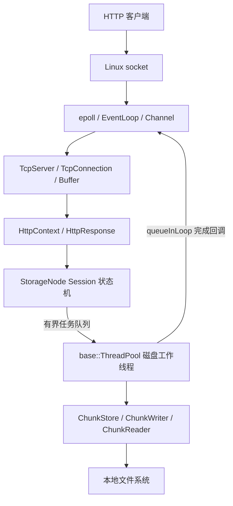
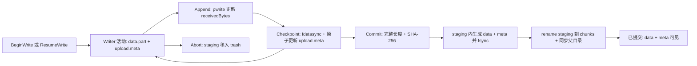
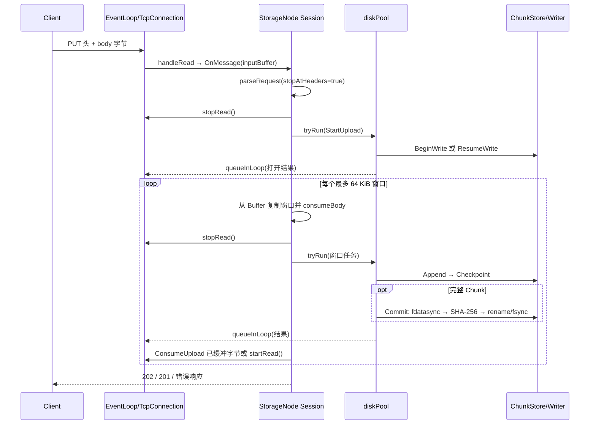
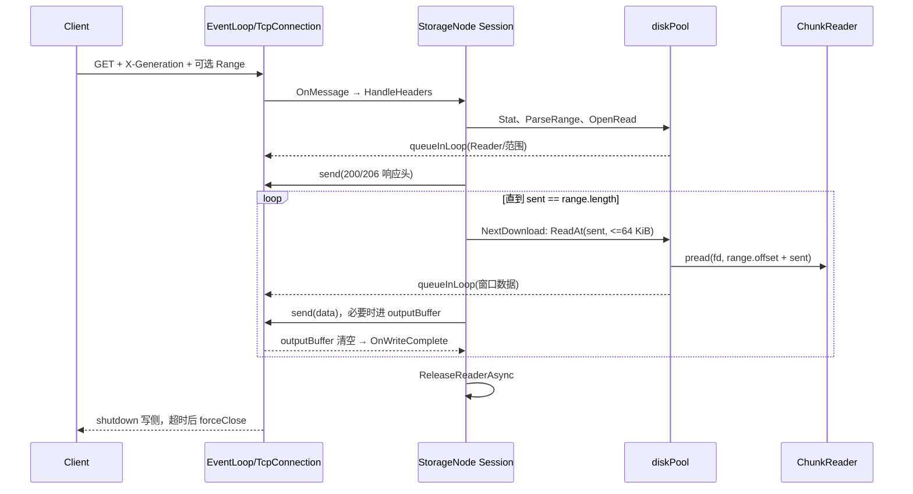

# ChunkStore 与 Storage Node 源码学习指南

> 阅读基准：当前工作区的 C++17 源码、`README.md`、`PROJECT_ARCHITECTURE.md`、`NETWORK_FRAMEWORK_GUIDE.md`、`docs/object_storage_phase1_design.md`、`docs/storage_node_http.md` 与现有测试。本文描述**现有实现**；早期设计文档第 7 节对 HTTP 尚不能流式处理的判断属于当时的状态，不能代替现在的 `StorageNode.cc`。下文的“保证”指代码在其文件系统和调用顺序前提下试图提供的语义；测试验证范围单独说明。

## 1. 先建立整体心智模型

### 1.1 目录、目标与依赖

| 目录或目标 | 当前职责 | 关键入口 |
| --- | --- | --- |
| `base/`、`mymuduo_base` | 线程池、时间、日志等通用设施 | `base/ThreadPool.cc` |
| `net/`、`mymuduo_net` | Linux Reactor、非阻塞 TCP、连接 Buffer | `net/EventLoop.cc`、`net/TcpConnection.cc` |
| `net/`、`mymuduo_http` | HTTP 请求增量解析与响应序列化；可选构建 | `net/HttpContext.cc`、`net/HttpResponse.h` |
| `storage/common/`、`object_store_common` | Chunk 描述符、SHA-256、`Status`/`Result` | `storage/common/Types.h`、`Checksum.cc` |
| `storage/chunk_store/`、`chunk_store` | 独立于网络的本地 Chunk 生命周期与磁盘恢复 | `ChunkStore.cc`、`ChunkWriter.cc`、`ChunkReader.cc` |
| `storage/node/`、`storage_node_service` | HTTP 到 ChunkStore 的适配、会话、磁盘任务与背压 | `StorageNode.cc` |
| `apps/storage_node.cc` | 参数、信号与进程启动 | `main` |
| `tests/` | 基础库、ChunkStore 和真实 socket 集成测试 | `tests/storage/chunk_store_test.cc`、`tests/integration/storage_node_test.py` |

目标依赖是 `storage_node_service → chunk_store + mymuduo_http → mymuduo_net + mymuduo_base`，而 `chunk_store → object_store_common → OpenSSL libcrypto`。`ChunkStore` 不知道 HTTP、连接和 Reactor。旧 Web 文件管理系统在 `legacy/file_manager/`，默认不构建；它不是此数据面的前身运行路径。[`CMakeLists.txt`](../CMakeLists.txt)、[`storage/CMakeLists.txt`](../storage/CMakeLists.txt)



当前是**单节点、单 Chunk 数据服务**：节点接受 PUT、GET、HEAD、DELETE，支持单段 Range、分段续传、SHA-256 提交校验与启动恢复。`ChunkDescriptor` 保留 `objectId`、`objectVersion`、`index`、`logicalOffset`、`generation`，但这里没有全对象目录、Coordinator、节点注册、复制或副本恢复。没有 TLS、认证、HTTP chunked 上传、连接复用和多段 Range。设计文档中的 Coordinator、Client 和副本模型是规划，不应当作可调用的实现。[`storage/common/Types.h`](../storage/common/Types.h)、[`storage/node/StorageNode.cc`](../storage/node/StorageNode.cc)

### 1.2 一次请求的控制流与数据流

**控制流**：`epoll_wait → EventLoop::loop → Channel::handleEvent → TcpConnection::handleRead → StorageNode::OnMessage → HandleHeaders`；需要阻塞磁盘的工作交给 `diskPool_.tryRun`，工作线程完成后用 `EventLoop::queueInLoop` 回到同一个 I/O 线程，改变 `Session`、发送响应。**数据流**：上传字节走 `socket → inputBuffer_ → 64 KiB std::string → pwrite(data.part)`；下载走 `pread(data) → 64 KiB std::string → send / outputBuffer_ → socket`。这里“异步”是**事件驱动网络 + 工作线程执行同步磁盘系统调用**，不是内核异步文件 I/O。[`net/EventLoop.cc`](../net/EventLoop.cc)、[`storage/node/StorageNode.cc`](../storage/node/StorageNode.cc)

## 2. ChunkStore：数据模型和对象关系

### 2.1 标识、目录与元数据

`ChunkKey` 是 `(chunkId, generation)`；`ChunkDescriptor` 再包含对象 UUID、版本、块序号、逻辑偏移、完整大小、SHA-256 和格式版本。ID 要求 36 字符小写 UUID 形式，摘要是 64 字符的小写十六进制字符串。当前只有 SHA-256，默认单 Chunk 最大 256 MiB、元数据文件最大 16 KiB。`generation` 防止传入旧代数误读/误删，但最终路径只按 `chunkId` 组织，因此一个 ID 同时只能有一个已提交版本。[`storage/common/Types.h`](../storage/common/Types.h)、[`storage/common/Checksum.cc`](../storage/common/Checksum.cc)、[`storage/chunk_store/ChunkStore.h`](../storage/chunk_store/ChunkStore.h)

```text
<root>/
  .chunk-store.lock
  chunks/ab/cd/<chunk-id>/data, meta
  staging/<chunk-id>.<upload-id>.<generation>.tmp/data.part, upload.meta
  trash/                       # 删除或 Abort 后移动到此处
  quarantine/                  # 恢复时发现不合法状态的隔离区
```

`ab/cd` 从去掉连字符的 Chunk ID 前四个十六进制字符取得，避免所有 Chunk 堆在一个目录。磁盘上的 `meta` 与 `upload.meta` 是严格字段集合的 `key=value` 文本；`upload.meta` 比最终描述符多 `upload_id`、`durable_bytes`、`expires_at_micros`。`ReadFields` 限制文件大小、拒绝重复字段，解析函数检查格式、ID、整数和摘要。磁盘路径只由校验过的 ID 构造，HTTP object key 不参与本地路径。[`storage/chunk_store/ChunkStore.cc`](../storage/chunk_store/ChunkStore.cc) `ReadFields`、`ParseDescriptorFields`、`ParseUpload`、`FinalPath`、`StagingPath`

### 2.2 三个核心对象为何这样分工

| 对象 | 重要成员与状态 | 职责、所有权 |
| --- | --- | --- |
| `ChunkStore` | `root_`、`lockFd_`、64 把 `mutexes_`、`activeChunks_`/`activeAttempts_`、`liveWriters_`、恢复报告 | 调用方拥有；初始化根目录并恢复，仲裁同一 Chunk 的状态转换，打开 Writer/Reader。`flock` 在 Store 存活期间独占协作式本地 root。 |
| `ChunkWriter` | `store_` 裸指针、staging 目录、fd、描述符、`receivedBytes_`、`durableBytes_`、`mutex_`、`registered_`/`finished_`/`committed_` | `unique_ptr` 由调用方拥有；连续追加、检查点、提交或放弃。其方法由自身锁串行化；必须先于 Store 析构。 |
| `ChunkReader` | 独立的 fd、描述符副本、`ByteRange {offset,length}` | `unique_ptr` 由调用方拥有；`ReadAt` 的偏移相对选中范围，使用 `pread`，不维护共享文件位置。 |

Store 的 striped mutex 按 Chunk ID 哈希，短时串行化 Begin/Resume/Commit/Abort/Stat/OpenRead/Delete；不同 ID 通常可并发，哈希碰撞会额外串行。活动登记则在 Writer **整个未完成生命期**阻止第二个同 Chunk Writer 和 DELETE，不能用短时 mutex 代替。`liveWriters_` 是另一件事：即使 Writer 已 Commit/Abort，只要对象未析构，Store 析构就 `std::terminate()`；这检测关闭顺序错误，不让并发析构变安全。锁顺序是 Chunk 锁先于活动登记锁。Reader 拿到 fd 后可继续读已经被 rename 到 trash 的 inode，这是 Unix 打开文件描述符的语义；头文件仍要求 Reader 不超过 Store 生命周期。[`storage/chunk_store/ChunkStore.h`](../storage/chunk_store/ChunkStore.h)、[`ChunkWriter.h`](../storage/chunk_store/ChunkWriter.h)、[`ChunkReader.h`](../storage/chunk_store/ChunkReader.h)、[`ChunkStore.cc`](../storage/chunk_store/ChunkStore.cc) `MutexFor`/`RegisterWriter`

`Status` 表示可预期错误，`Result<T>` 把状态与值放在一起：`kNotFound`、`kConflict`、`kOffsetMismatch`、`kChecksumMismatch`、`kStaleGeneration`、`kNoSpace`、`kCorrupt`、`kIoError` 等。`Verify` 的摘要不匹配是一个**成功返回的检验结果**（`checksumMatches=false`）；读文件失败才是外层 `Result` 错误。这让“数据确实损坏”与“没有完成校验”分开。[`storage/common/Status.h`](../storage/common/Status.h)、[`storage/chunk_store/ChunkStore.cc`](../storage/chunk_store/ChunkStore.cc) `Verify`

## 3. ChunkStore：写入、可见性与恢复

### 3.1 写入状态与精确调用顺序



`Initialize` 先创建并同步 root 及子目录，获取 `.chunk-store.lock` 的非阻塞独占 `flock`，检查区域位于同一设备，再 `Recover`；全部成功才设置 `initialized_`。同一 root 的第二个协作进程会在对外服务前失败。`flock` 是 advisory lock，不能阻挡不遵守协议的进程；锁文件不能在服务运行中删除或替换。[`storage/chunk_store/ChunkStore.cc`](../storage/chunk_store/ChunkStore.cc) `Initialize`

`BeginWrite` 验证完整描述符与 upload ID，先看最终目录：相同描述符返回 `kAlreadyCommitted`，不同描述符返回冲突；否则登记活动 Writer，建 staging 目录，原子写 `upload.meta`，以 `O_EXCL` 建 `data.part`，同步 staging 自身和父目录，再返回 Writer。原有同名 staging 目录不会隐式覆盖，调用方需 `ResumeWrite`。失败会释放进程内登记，但磁盘上可能留下待恢复目录；错误不等于“完全没有副作用”。[`storage/chunk_store/ChunkStore.cc`](../storage/chunk_store/ChunkStore.cc) `BeginWrite`

`Append(offset, data, len)` 要求 offset 恰好等于 `receivedBytes_`、不超过声明大小；循环 `pwrite` 应对部分写与 `EINTR`。只有整次写入成功才增加 `receivedBytes_`。`Checkpoint` 先 `fdatasync(data.part)`，再用 `AtomicWrite` 替换 `upload.meta`，成功后更新 `durableBytes_`。因此两个偏移不同：`receivedBytes_` 是进程当前可继续追加处，`durableBytes_` 是检查点确认的恢复起点。若 `pwrite` 中途失败，磁盘可含尾部碎片，但不会提前宣称其可恢复；恢复按元数据前缀截断。[`storage/chunk_store/ChunkWriter.cc`](../storage/chunk_store/ChunkWriter.cc) `Append`/`Checkpoint`

`Commit` 先要求完整大小，再同步数据、以 64 KiB 缓冲遍历文件计算 SHA-256；只有摘要相同才进入发布阶段。在 Chunk 锁内关闭 fd、将 `data.part` 改名 `data`、原子生成 `meta`、删除 `upload.meta`、同步 staging 目录、准备最终分片目录，然后 `rename` **整个 staging 目录**为最终 Chunk 目录。`MoveDirectory` 同步源父目录与目标父目录，成功后释放活动登记。如果目标已存在，只对描述符和实际数据均相同的对象认作幂等；冲突目录进入隔离/回收路径。`Abort` 将 staging 目录移入 trash；析构未提交 Writer 只关闭 fd 和取消活动登记，**不会自动 Abort**，这是断点续传成立的原因。[`storage/chunk_store/ChunkWriter.cc`](../storage/chunk_store/ChunkWriter.cc) `Commit`/`Abort`/析构、[`storage/chunk_store/ChunkStore.cc`](../storage/chunk_store/ChunkStore.cc) `MoveDirectory`

### 3.2 原子性不等于持久性

`rename` 在同一文件系统内使目录名切换原子可见：读者看到的是 staging 或最终目录，而不是半个最终 Chunk。`fdatasync(data.part)` 保证文件数据及读取它所需的元信息进入持久化边界；`fsync(meta.tmp)` 保证元数据内容；`rename(meta.tmp, meta)` 替换名字；`fsync(所在目录)` 保证目录项更新；跨父目录的 `rename` 还要同步**源父目录和目标父目录**。`AtomicWrite` 与 `MoveDirectory` 对应这些步骤。`Initialize` 检查 `chunks`、`staging`、`trash`、`quarantine` 同设备，避免跨设备 rename 失去该语义。[`storage/chunk_store/ChunkStore.cc`](../storage/chunk_store/ChunkStore.cc) `DataSync`/`AtomicWrite`/`MoveDirectory`/`Initialize`

系统调用失败尤其是 rename 后 fsync 失败，可能出现“当前进程可见，但掉电后能否留存不确定”。`Commit` 因而返回错误；`LoadCommitted` 在报告已提交前再次同步最终父目录。即便如此，单凭一条错误响应也不能倒推出 Chunk 不存在。这里的持久化语义依赖本地文件系统正确实现 `fsync`、存储设备兑现刷盘；现有测试使用错误注入与进程重启，没有模拟真实断电。[`storage/chunk_store/ChunkStore.cc`](../storage/chunk_store/ChunkStore.cc) `LoadCommitted`、[`docs/storage_node_http.md`](storage_node_http.md)

### 3.3 启动恢复：按磁盘证据决定状态

| 启动时看到的状态 | `Recover` 实际动作 | 对外语义 |
| --- | --- | --- |
| `chunks/.../data + meta` 路径、元数据、文件大小一致 | 计为 healthy，同步最终父目录；不全量重算 SHA-256 | 可 `Stat`/`OpenRead`；静默位翻转须显式 `Verify` 才发现 |
| staging 中 `data.part + upload.meta` | 按 `min(durable_bytes, 实际长度)` 截断或回退元数据；未过期则保留 | 可 `ResumeWrite`，未提交部分不可 GET |
| staging 中 `data + meta` 且无 upload.meta | 校验完整 SHA-256，若最终目录空缺则补做目录发布 | 完成中断的 Commit |
| staging 中 `data + upload.meta` 而无 data.part | 校验数据，补建最终 meta 并发布或处理重复目标 | 处理更早提交中断点 |
| 元数据不合法或数据不完整 | 移入 quarantine；过期正常上传移入 trash | 不作为有效 Chunk 提供 |

恢复通过扫描目录完成，不是事务日志重放；`RecoveryReport` 计数 healthy、resumable、completed、quarantined、trashed。`trash` 没有后台物理清理；正常运行中到期上传也不是定时清扫，而是启动恢复时检查。恢复正常 staging 前缀不重算 SHA-256，最终提交会重新校验全 Chunk。[`storage/chunk_store/ChunkStore.cc`](../storage/chunk_store/ChunkStore.cc) `Recover`、`ResumeWrite`

### 3.4 读取、删除、并发交错

`Stat` 在 Chunk 锁下解析最终 `meta`、核对路径和 `data` 大小、检查 generation。`OpenRead(key, range)` 同锁完成上述检查和 `open(data)`，范围参数是 `{起点, 精确长度}`，允许零长度；Reader 的 `ReadAt(relativeOffset)` 做一次 `pread`，返回可能小于请求长度，调用方负责推进。无 Range 重载先 `Stat` 再调用有 Range 重载，中间若并发 DELETE，后续打开可返回 NotFound。`Delete` 同锁检查活动 Writer，校验 generation 后将最终目录移入 trash；不存在视为成功。已经打开的 Reader 的 fd 仍指向原 inode，所以读与删不必让 Reader 长期持锁。[`storage/chunk_store/ChunkStore.cc`](../storage/chunk_store/ChunkStore.cc) `Stat`/`OpenRead`/`Delete`、[`storage/chunk_store/ChunkReader.cc`](../storage/chunk_store/ChunkReader.cc)

## 4. Storage Node：Reactor、线程与会话

### 4.1 网络基础如何协作

`Acceptor` 对监听 socket 接受非阻塞连接，`TcpServer::newConnection` 建立 `TcpConnection` 并放进连接表。`StorageNode` 构造时调用 `server_.setThreadNum(0)`，所以该节点的所有连接由主 `EventLoop` 处理；框架本身支持多 I/O Loop，但本节点当前没有启用。`EventLoop` 的 `Poller` 实际使用 epoll；`Channel` 持有 fd、关注事件和回调，不拥有 fd；`Socket` RAII 关闭 fd。`Channel::tie` 在事件回调执行期间保住连接对象。`eventfd` 唤醒跨线程投递的回调，`timerfd` 让超时也由同一个事件循环处理。[`net/Acceptor.cc`](../net/Acceptor.cc)、[`net/TcpServer.cc`](../net/TcpServer.cc)、[`net/EventLoop.cc`](../net/EventLoop.cc)、[`net/Channel.cc`](../net/Channel.cc)、[`net/TimerQueue.cc`](../net/TimerQueue.cc)

`TcpConnection::handleRead` 调 `Buffer::readFd`：它用 `readv` 将数据读进 Buffer 可写区，空间不足时再利用 64 KiB 栈上临时区并追加。`Buffer` 用 `readerIndex_`/`writerIndex_` 表示已读、可读和可写区域；`retrieve` 推进索引，追加时优先整理空间，必要时扩容。它本身没有硬容量上限。非阻塞 `readv` 的 `EAGAIN` 表示本轮无更多数据，EOF (`n==0`) 触发关闭。`sendInLoop` 先尝试 `send(..., MSG_NOSIGNAL)`，剩余数据放入 `outputBuffer_` 并监听 POLLOUT；`handleWrite` 后续继续发送。`writeCompleteCallback` 代表**用户态输出 Buffer 已被内核接收完**，不代表对端应用已经读取，更不代表持久化。[`net/Buffer.h`](../net/Buffer.h)、[`net/Buffer.cc`](../net/Buffer.cc)、[`net/TcpConnection.cc`](../net/TcpConnection.cc)

`HttpContext` 的解析状态为请求行 → headers → body → 完成。普通 `HttpServer` 会把 body 追加到 `HttpRequest::body()`；Storage Node **直接使用 `TcpServer`**，调用 `parseRequest(..., stopAtHeaders=true)` 在头后停住，只用 `consumeBody` 更新已消费长度，因此 PUT 不经过整包 body 聚合。`HttpResponse` 仍用于小响应或 GET 头，真正下载的正文由 `TcpConnection::send` 分块发送。HTTP 头查询不区分大小写，`Content-Length` 按非负十进制解析，chunked 被拒绝。每连接只处理一个请求。[`net/HttpContext.cc`](../net/HttpContext.cc)、[`net/HttpRequest.h`](../net/HttpRequest.h)、[`net/HttpResponse.h`](../net/HttpResponse.h)、[`storage/node/StorageNode.cc`](../storage/node/StorageNode.cc) `OnMessage`

### 4.2 三类线程、一个会话状态机

| 执行位置 | 执行内容 | 不应跨越的边界 |
| --- | --- | --- |
| 主 EventLoop 线程 | socket/Buffer、HTTP 解析、`Session` 状态转换、响应和定时器 | 不做阻塞文件读写或全文件哈希 |
| `diskPool_`（默认 4 线程，待处理队列 64） | `BeginWrite`/`ResumeWrite`、`Append`/`Checkpoint`/`Commit`、`Stat`/`OpenRead`/`ReadAt`、`Delete` | 不直接操作连接 Buffer；完成后 `queueInLoop` |
| `cleanupPool_`（1 线程） | 析构 Writer/Reader，避免连接回调中同步关闭文件或取消活动登记 | 关闭前必须完成在途磁盘任务 |

`Session` 放在 `TcpConnection::context_` 中，`shared_ptr` 持有；包含 `HttpContext parser`、Chunk ID/generation/upload ID、请求描述符、当前 offset、`unique_ptr<ChunkWriter/Reader>`、下载范围与 `sent`、`diskBusy`、`lastActivity`、`idleTimer`。阶段可能取 `kHeaders`、`kOpening`、`kUpload`、`kDiscard`、`kBusy`、`kDownload`、`kDone`，并非每个请求都会走遍这些状态。阶段表示连接当前能接受什么事件，而 `diskBusy` 防止重复提交下载读取。`Session` 析构断言 Reader/Writer 已释放。[`storage/node/StorageNode.cc`](../storage/node/StorageNode.cc) `Session`、[`storage/node/StorageNode.h`](../storage/node/StorageNode.h)

磁盘任务捕获 `SessionPtr` 保持状态存活，连接只用 `weak_ptr`；完成回调先 `lock()` 检查连接是否仍在，断开后不再回包，而释放句柄。`Session` 的普通字段由 I/O 线程推进；磁盘工作线程在该连接的阶段停住时使用 Writer/Reader，并把结果投回 I/O 线程。存储层允许不同连接并发，但同 Chunk 的状态由 Store 锁/登记协调。`ThreadPool::tryRun` 是非阻塞提交：队列满或停止就返回 false，节点回 503 或关闭下载连接，不在 I/O Loop 上等空位。[`base/ThreadPool.cc`](../base/ThreadPool.cc) `tryRun`、[`storage/node/StorageNode.cc`](../storage/node/StorageNode.cc)

### 4.3 HTTP 接口的真实路径

| 方法 | 关键路径 | 主要结果 |
| --- | --- | --- |
| PUT | `HandleHeaders → StartUpload → ConsumeUpload → SubmitUploadWindow` | 连续片段可 202；完整且校验/提交成功 201；相同已提交描述符先丢弃本次 body 再 200；偏移冲突 409；摘要不符 422；不确定提交 503 + `X-Commit-State: unknown` |
| HEAD | `StartLookup → Stat`，未找到且有规范 upload ID 时尝试 `ResumeWrite` | 已提交 200（含完整大小的 Content-Length）；可恢复 staging 308 + durable offset；活动 Writer 可能 409 |
| GET | `StartLookup → Stat → ParseRange → OpenRead → NextDownload` | 全量 200；单段合法范围 206；不满足或不支持的范围 416 + `Content-Range: bytes */size` |
| DELETE | `StartDelete → ChunkStore::Delete` | 成功或不存在 204；generation 过旧或活动 Writer 409；不删除 staging |

URL 必须是 `/v1/chunks/{规范 UUID}`，PUT 的描述符和偏移来自一组 `X-*` 头，其他方法需要 `X-Generation`。Range 实现支持 `bytes=start-end`、`start-`、`-suffix`，只接受一个范围。响应通过 `Reply` 走小型 `HttpResponse`；GET 自行构造头再流式正文。`HttpCode` 将 Store 状态映射到 HTTP 码，但网络关闭后已发出的头无法改成新的错误码。[`storage/node/StorageNode.cc`](../storage/node/StorageNode.cc) `ParseRange`、`ParseUploadRequest`、`HandleHeaders`、`HttpCode`

## 5. 按真实执行顺序追踪关键链路

### 5.1 PUT：从 TCP 到原子发布



第一次 `OnMessage` 可能已经把头和部分 body 放在同一 `inputBuffer_` 中。解析器只消耗头，`StartUpload` 停止继续从 socket 读取；磁盘打开 Writer 完成后，`ConsumeUpload` 先处理**已经在 Buffer 中**的字节。每次最多复制 64 KiB 到任务拥有的 `std::string`，消费 Buffer，工作线程 `pwrite` 后 `Checkpoint`。若这次请求 body 还没结束，回 I/O 线程继续消费现存 Buffer 或 `startRead`；若请求结束且完整 Chunk 已收到，则 Commit。一个 HTTP PUT 可以只传一个片段，202 后关闭连接；下一个 PUT 用相同 upload ID 和准确 offset 续传。[`storage/node/StorageNode.cc`](../storage/node/StorageNode.cc) `OnMessage`、`StartUpload`、`ConsumeUpload`、`SubmitUploadWindow`

这里至少有一次 **Buffer → std::string** 的用户态复制，`pwrite` 再从该内存读到内核；不是零拷贝。选择它换来简单所有权：输入 Buffer 可立即 `retrieve`，磁盘任务持有自己的字节；不需要跨线程共享可变 Buffer。每个连接只挂起一个窗口任务，任务队列和连接数有限，所以不会随完整 Chunk 大小累积内存。`Checkpoint` 每窗口一次，提供细粒度续传偏移，代价是频繁 fdatasync、元数据写入与目录同步。[`storage/node/StorageNode.cc`](../storage/node/StorageNode.cc) `kWindow`、[`storage/chunk_store/ChunkWriter.cc`](../storage/chunk_store/ChunkWriter.cc) `Checkpoint`

对象生命期：`Session` 在连接建立时创建；`writer` 在磁盘线程打开并装入会话；已提交或回复错误时 `Reply → ReleaseWriterAsync` 把 Writer 交给 cleanupPool 析构。客户端中途断开时，已提交的窗口任务继续完成检查点，之后不再发送响应，Writer 被释放但 staging 留下。HEAD 的 durable offset 才是客户端下一次可安全续传的依据；断线瞬间本地以为已发出的字节不等于 durable offset。**已经进入 Commit 的断线请求仍可能发布成功**。[`storage/node/StorageNode.cc`](../storage/node/StorageNode.cc) `OnConnection`、`ReleaseWriterAsync`、`SubmitUploadWindow`

### 5.2 GET：一个发送窗口换一个磁盘读取窗口



`StartLookup` 先 `Stat` 取得描述符，用 `ParseRange` 算 `{offset,length}`，再 `OpenRead` 打开 fd。`NextDownload` 每次只分配本段剩余长度与 64 KiB 的较小者，工作线程一次 `ReadAt`，回 I/O 线程 `send`；`sent` 记录**已经交给连接发送接口**的字节数，不是客户端确认字节数。输出 Buffer 被 `send`/POLLOUT 排空后才调用 `OnWriteComplete` 安排下一次读取，因此慢读客户端不会使本连接持续从磁盘预读。`TcpConnection` 的高水位回调默认阈值 64 MiB，只是通知且 Node 没有使用；真正背压是此处的**单窗口等待写完成**。[`storage/node/StorageNode.cc`](../storage/node/StorageNode.cc) `StartLookup`/`NextDownload`/`OnWriteComplete`、[`net/TcpConnection.cc`](../net/TcpConnection.cc) `sendInLoop`/`handleWrite`

读取可能短于要求的长度；正常短读后 `sent` 前进，下一轮继续。若 `ReadAt` 返回错误或在仍需数据时返回 0，节点强制关闭连接。响应头可能已发，故客户端只能从 Content-Length 不足发现本次下载失败，不能指望此时得到一个新的 500。GET 不逐次全量重算 SHA-256，只返回 `meta` 中的摘要；客户端可对完整 Chunk 自行验证，服务端 `Verify` 是独立存储 API。结束时 Reader 由 cleanupPool 关闭，连接 `shutdown()` 完成写半关闭，另有 5 秒强制关闭定时器。[`storage/node/StorageNode.cc`](../storage/node/StorageNode.cc) `NextDownload`/`OnWriteComplete`

### 5.3 断线、超时、磁盘失败、崩溃与并发

| 场景 | 代码实际路径与资源结果 | 学习时应抓住的边界 |
| --- | --- | --- |
| 上传中主动断开 | `handleRead` 读到 EOF/错误关闭 → `OnConnection` 取消定时器、清上下文；在途任务仍持 `SessionPtr`，完成后释放 Writer；staging 保留检查点 | 不因 TCP 断开自动回滚 durable 字节，HEAD/恢复决定续传点 |
| 下载方长期不读取 | socket 发送缓冲满时 `send` 进入 `outputBuffer_`，POLLOUT 等待，下一块 `ReadAt` 不会调度；空闲计时器可能强制关闭 | `OnWriteComplete` 是 Buffer 排空，不是客户端 ACK；内核 socket 缓冲也占资源 |
| 上传磁盘 `pwrite`/`fdatasync`/元数据写失败 | Writer 返回 `Status`，窗口完成回调映射 HTTP 错误并报告 durable offset；`ENOSPC` 通常映射为 503 | Append 可能留下未计入 received/durable 的物理尾部；恢复按 durable 元数据裁剪 |
| Commit 目录移动或 fsync 失败 | `Commit` 错误；HTTP 对非摘要错误返回 503 + `X-Commit-State: unknown` | rename 可能已发生，不能把 503 理解为“未提交”；需 HEAD 或重启恢复核实 |
| 数据只写一部分时进程崩溃 | 没有最终目录时普通 GET/Stat 不可见；启动 `Recover` 保留或裁剪到检查点 | 物理断电结果受文件系统兑现 fsync 的能力约束；现有测试不是断电实验 |
| 同 Chunk 两个上传 / 上传加 DELETE | `MutexFor` 串行状态转换，`activeChunks_` 拒绝第二活动 Writer 与 DELETE；相同已提交描述符可幂等返回 | Writer 活动登记是进程内规则，root flock 补足协作进程间独占 |
| 不同 Chunk 多连接 | 同一 I/O Loop 快速解析/发送，磁盘池可并行阻塞 I/O；偶然落在同一 stripe 的 ID 会串行状态转换 | 并发来自工作线程与多个连接的事件交错，不代表一个连接同时执行多个窗口 |
| 服务处理请求时收到 SIGTERM | `sigwait` 线程调用 `loop.quit`；`StorageNode` 析构置 stopping、停止并排空 diskPool、`drainPendingFunctors`；随后成员逆序析构使连接、清理池先于 Store 释放 | 停止语义是等待在途任务完成与清理，不是取消已进入磁盘的操作 |

空闲超时由每连接 `runEvery` 定时器检查 `lastActivity`，默认 60 秒；`OnMessage` 和 `OnWriteComplete` 更新它。它是当前实现的活动定义，不能推断为逐字节读写都延长时限。网络 `EAGAIN` 会等待下一次事件，`EINTR` 在 `pwrite`/`pread` 路径重试；TCP 层遇到 EOF、`EPIPE`/`ECONNRESET` 关闭连接。`handleError` 记录 SO_ERROR，但并非所有读错误都会立即形成 HTTP 响应。上述异常行为应从[`storage/node/StorageNode.cc`](../storage/node/StorageNode.cc) `OnConnection`/`SubmitUploadWindow`/`NextDownload` 与[`net/TcpConnection.cc`](../net/TcpConnection.cc) `handleRead`/`handleWrite`/`handleClose` 联合阅读。

## 6. 为什么这样设计：问题、方案、代价

| 设计决定 | 解决的问题与当前方案 | 代价和边界 |
| --- | --- | --- |
| Reactor + 非阻塞 socket | 一个 I/O Loop 用 epoll 管理多个连接，只有 fd 就绪才处理；eventfd 把磁盘完成回调带回其线程 | 单一 Node I/O Loop 是简化，复杂 CPU 工作仍会阻塞所有连接，故全文件哈希放在磁盘池 |
| `ChunkStore` 不依赖网络 | 可直接用临时目录测文件语义，HTTP 只做协议与状态映射 | HTTP 必须准确传递 Store 的“不确定结果”，不能自行猜测磁盘状态 |
| 64 KiB 上传/下载窗口 | 避免完整 256 MiB Chunk 进入用户态内存；Reader/Writer 生命周期清晰 | 多次复制与系统调用；窗口大小没有自适应调节 |
| 暂停读取 + 单窗口发送 | 慢磁盘时暂停 POLLIN，慢客户端时等 outputBuffer 排空才读下一块；有界任务队列、连接上限控制总压力 | `Buffer` 无硬上限，高水位只是通知；上限依赖 Node 逐阶段协议与连接接入规则，不能当作 Buffer 自带的普适保证 |
| 临时目录 + 整目录 rename | 未完成写入不会以最终 Chunk 路径暴露；恢复能辨认提交阶段 | 一次 Commit 涉及多次 fdatasync/fsync 和目录更新；中间错误仍有状态不确定窗口 |
| 按 Chunk 锁 + 活动 Writer 登记 | 同 Chunk 操作不互相覆盖，跨 Chunk 能并发；Writer 不长期持 mutex | stripe 哈希碰撞会导致额外等待，进程内规则需 root flock 补足跨进程互斥 |
| `unique_ptr` Writer/Reader + Session `shared_ptr` | fd 独占所有权，异步任务可保持会话活着，断线用 weak connection 避免错误回包 | 必须严格控制任务、清理池、Store 析构顺序；Writer 的 Store 裸指针不能独立延寿 Store |
| 按窗口 Checkpoint + Commit 全量 SHA | 断点续传到明确 durable offset，提交前确认完整内容 | 频繁同步牺牲吞吐；已提交数据的日常 GET 不全量校验，需客户端或显式 Verify |

这里没有引入通用存储接口、数据库、网络中间件或复杂任务调度器。单节点阶段直接组合 Store、TCP 与一个普通 `ThreadPool` 就可验证核心行为。未来若出现多节点协调、复制或更严格的吞吐要求，可在真实需求和测量下重新评估线程数、检查点频率、GC 与接口；当前代码不能据此推断已有这些能力。[`docs/object_storage_phase1_design.md`](object_storage_phase1_design.md)

## 7. 代码与测试应如何对应着读

### 7.1 先外后内的三轮阅读

1. **建立外部契约**：读[`README.md`](../README.md)、[`docs/storage_node_http.md`](storage_node_http.md)、[`storage/common/Types.h`](../storage/common/Types.h)、[`storage/chunk_store/ChunkStore.h`](../storage/chunk_store/ChunkStore.h)、[`storage/node/StorageNode.h`](../storage/node/StorageNode.h)。先回答“谁调用谁、一次 PUT 的输入输出是什么”。
2. **跟进一条上传与下载**：从[`apps/storage_node.cc`](../apps/storage_node.cc) `main` 到[`storage/node/StorageNode.cc`](../storage/node/StorageNode.cc) `OnMessage`、`StartUpload`/`SubmitUploadWindow`、`StartLookup`/`NextDownload`；并行看[`net/HttpContext.cc`](../net/HttpContext.cc) `parseRequest`、[`net/TcpConnection.cc`](../net/TcpConnection.cc) `handleRead`/`sendInLoop`/`handleWrite`。在纸上写出每次 `stopRead`、`startRead`、`queueInLoop` 前后的线程与 Session phase。
3. **深入磁盘协议与边界**：读[`storage/chunk_store/ChunkStore.cc`](../storage/chunk_store/ChunkStore.cc) 的 `AtomicWrite`、`MoveDirectory`、`Initialize`、`BeginWrite`、`ResumeWrite`、`LoadCommitted`、`Recover`；接着读[`ChunkWriter.cc`](../storage/chunk_store/ChunkWriter.cc) `Append`/`Checkpoint`/`Commit`，[`ChunkReader.cc`](../storage/chunk_store/ChunkReader.cc) `ReadAt`。最后对照测试模拟中断与失败点。

如需深挖 Reactor，可按[`NETWORK_FRAMEWORK_GUIDE.md`](../NETWORK_FRAMEWORK_GUIDE.md) 顺序读 `Buffer → Channel → EPollPoller → EventLoop → Acceptor → TcpServer → TcpConnection`。该旧指南中“Node 尚无流式 I/O/暂停读取”的段落是写作时点描述；目前以源码为准。

### 7.2 读复杂状态时观察什么

- **Writer**：每个调用前后列出 `receivedBytes_`、`durableBytes_`、`fd_`、`registered_`、`finished_`；尤其区分 Append 成功、Checkpoint 成功、Commit 返回成功。模拟 `rename` 后 `fsync` 失败时，不要把函数返回值直接当作磁盘事实。
- **Session**：按 `phase`、`diskBusy`、`offset`、`sent`、`writer`/`reader` 填一张时序表。留意磁盘任务持 `SessionPtr`、回调持连接 weak_ptr，连接断开后谁负责清理。
- **TcpConnection**：跟踪 `inputBuffer_`/`outputBuffer_`、Channel 的 POLLIN/POLLOUT、连接状态 `kConnected/kDisconnecting/kDisconnected`。部分发送时 `outputBuffer_` 的增长与排空决定下一次下载读取。
- **Store**：分开看 `mutexes_` 的短时互斥、`activeChunks_` 的活动 Writer 排他、`lockFd_` 的跨进程协作锁、`liveWriters_` 的析构顺序检测；四者解决不同问题。

学习这些路径需要掌握：C++ RAII、`unique_ptr`/`shared_ptr`/`weak_ptr`、lambda 捕获与对象生命期；`std::mutex` 锁顺序和线程归属；非阻塞 socket 的 `EAGAIN`、短读短写、epoll LT 事件、`eventfd`/`timerfd`；`pread`/`pwrite` 与共享文件偏移的区别；`fdatasync`、`fsync`、`rename` 与目录项持久化。读代码时把“系统调用已返回”“数据已进入内核缓冲”“元数据被确认持久化”“客户端已收到”分别标记，它们不是同一时刻。

### 7.3 测试验证了什么，仍不能推出什么

| 测试 | 直接覆盖的机制 | 不应外推的结论 |
| --- | --- | --- |
| [`tests/storage/chunk_store_test.cc`](../tests/storage/chunk_store_test.cc) | Append 偏移、Range 读取、重复提交、checksum 失败、显式 Verify、Delete 与活动 Writer、重启裁剪/补发布、Store/Writer 析构顺序；通过 `--wrap=fsync` 定向注入 root/staging/提交目录同步失败，验证错误传播与重试 | 没有真实断电、所有文件系统故障交错、长期运行故障率证明 |
| [`tests/integration/storage_node_test.py`](../tests/integration/storage_node_test.py) | 真实 socket 的 8 MiB 分段 PUT/GET、HEAD 续传、Range、重复上传、断线重启、不同 Chunk 并发、慢读、模拟慢磁盘、活动 Writer 与 DELETE、关闭排空、root 竞争、空闲超时与若干 RSS 阈值 | RSS 场景不是所有连接数、头部输入和内核缓冲的形式化内存上界；没有覆盖每种磁盘错误到 HTTP 的端到端映射 |
| `tests/buffer_test.cc`、`http_context_test.cc`、`tcp_server_test.cc` 等 | Buffer/HTTP 增量解析、并发 TCP 与跨线程回调的基础行为 | 不能替代整个 Storage Node 的故障与一致性证明 |

按现有 `tests/CMakeLists.txt`，这些组成 CTest 测试。仓库的 `docs/storage_node_http.md` 记录此前 Debug 与 ASan/UBSan 完整测试均为 **8/8 通过**；本指南编写只阅读源码和测试，没有把旧测试记录冒充本次重新执行结果。当前可重复运行 `ctest --test-dir build --output-on-failure`，构建目录配置不同则先按 README 构建。[`tests/CMakeLists.txt`](../tests/CMakeLists.txt)

## 8. 一页回顾

`ChunkStore` 的核心是**未提交数据只在 staging、durable offset 由数据同步加元数据原子替换确认、完整 SHA-256 通过后才以目录 rename 发布**。`StorageNode` 的核心是**一个 I/O Loop 管连接状态，工作线程做同步磁盘 I/O，以单个 64 KiB 窗口和完成回调控制数据推进**。上传必须区分收到、写入、检查点和提交；下载必须区分读出、交给发送 Buffer 与客户端实际接收。跨线程的 Session/连接所有权、Store 与 Writer 的销毁顺序，以及 rename 后 fsync 失败的未知状态，是继续开发前最值得反复在源码和测试中练习的三条主线。
